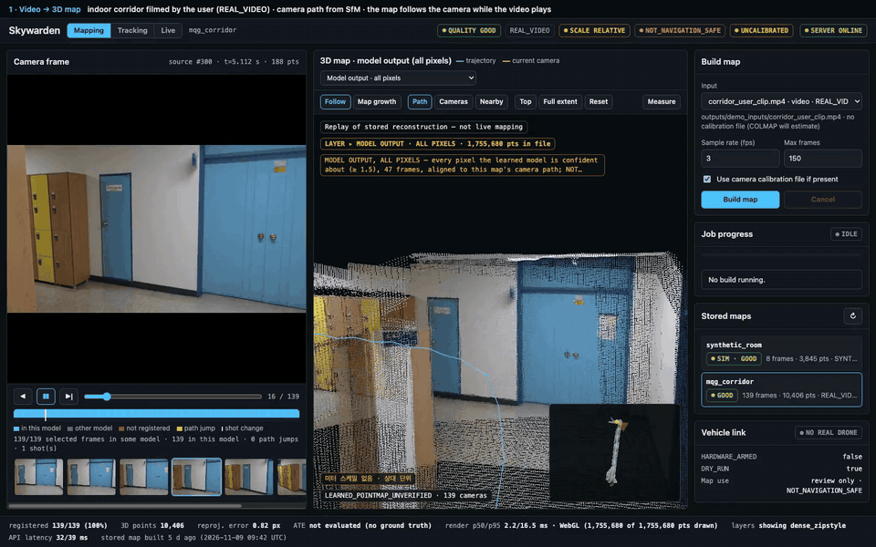
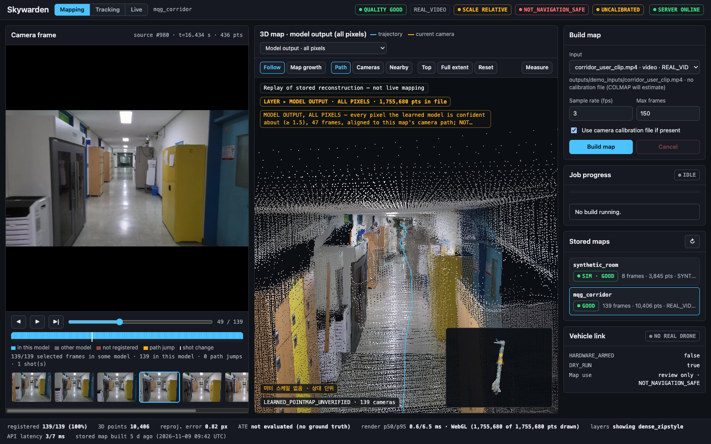
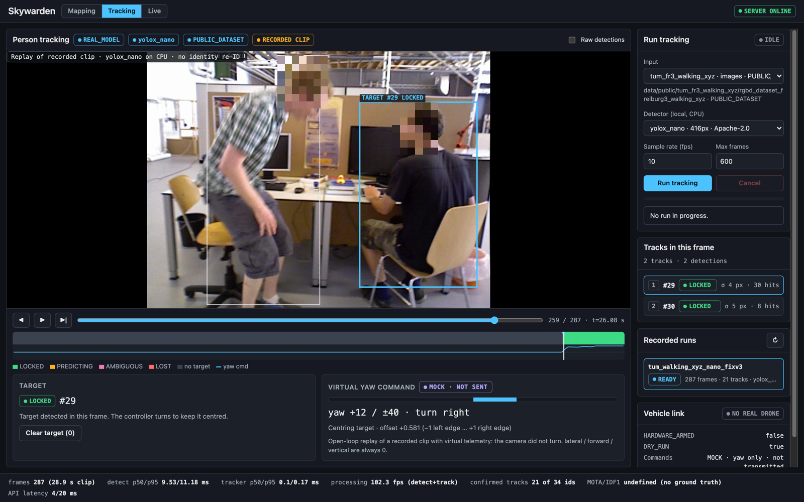
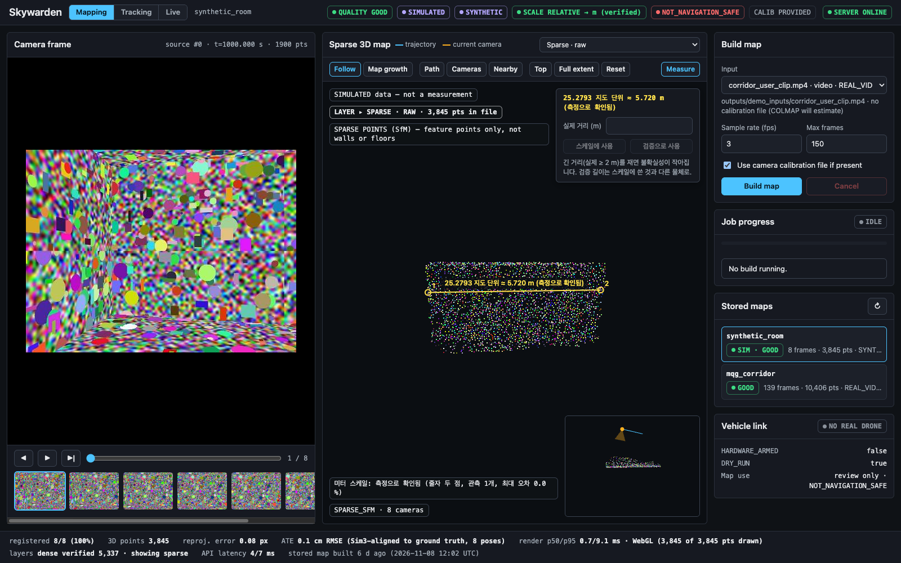
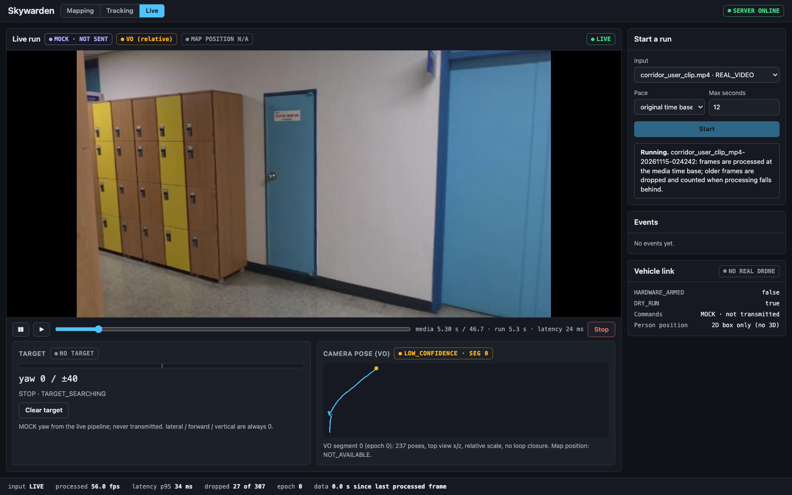
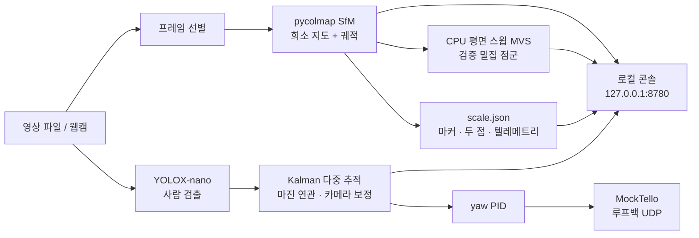

# Skywarden

카메라 영상 하나를 입력으로 받아 **3D 지도 생성 → 사람 검출·추적 → 제어 명령 생성**까지 이어지는 공간 인식 시스템을 처음부터 구축한 프로젝트입니다. 특정 기체를 만드는 것이 아니라, 각 단계를 교체 가능한 모듈로 나누고 단계마다 결과를 측정·검증하는 파이프라인과 그것을 운영하는 로컬 콘솔을 만드는 데 초점을 둡니다. 드론은 이 시스템의 한 가지 출력 대상이며, 지금은 가상 기체(MOCK)로만 연결됩니다. 모든 처리는 이 컴퓨터 안에서 끝나며 외부 API·업로드·실기체 명령이 없습니다.

## 시스템 설계 원칙

- **단계 분리와 계약.** 입력(영상·웹캠) → 프레임 선별 → 지도(SfM·MVS) → 스케일 → 검출·추적 → 제어 → 출력(Mock 기체)을 독립 모듈로 나누고, 단계 사이는 파일 형식과 스키마(`map_report.json`, `scale.json`, `timeline.jsonl` 등)로만 주고받습니다.
- **검증 우선.** 모든 산출물에 출처 라벨(`REAL_VIDEO` / `PUBLIC_DATASET` / `SIMULATED` / `MOCK`)과 신뢰 라벨(검증됨 / 모델 추정 / 미검증)을 붙이고, 합격 기준은 실행 전에 정해 결과를 보고 바꾸지 않습니다. 기준을 못 넘은 변경은 기본값으로 켜지 않고 trial로 남깁니다.
- **안전 게이트.** 출력 단계는 `HARDWARE_ARMED=false`·루프백 전용이 기본이며, 판단이 애매하면(두 사람이 겹쳐 구분이 안 됨 등) 추격 대신 정지합니다.
- **관측 가능성.** 처리 시간·지연·누락 프레임·품질 판정·추적 상태를 기록하고 콘솔에서 바로 보여 줍니다.
- **재현성.** 고정 시드, 원시 증거 보관, 테스트 204개와 CI, 공개 데이터셋만 사용.



전체 데모 영상(66 s): [docs/media/skywarden_demo.mp4](docs/media/skywarden_demo.mp4) — 장면 구성과 출처는 [docs/media/README.md](docs/media/README.md).

| 직접 촬영한 복도 영상의 3D 지도 (모델 추정 레이어) | 사람 추적과 MOCK yaw 명령 (송신 안 함) |
|---|---|
|  |  |
| **미터 스케일 측정 흐름 (합성 장면)** | **라이브 실행: 검출·추적·VO·MOCK 제어** |
|  |  |

<sub>복도: 프로젝트 작성자가 직접 촬영한 실내 복도 영상(`REAL_VIDEO`). 지도 화면은 학습 모델 깊이를 우리 SfM 카메라 경로에 놓은 **모델 추정** 레이어이며, 검증된 희소 지도는 139/139 프레임·10,406점입니다. 합성 장면: 이 저장소 코드가 만든 방으로, 기능 흐름을 보여 주는 화면입니다 — 입력한 길이가 장면의 정답 배율에서 나온 값이라 오차 0.0 %는 정확도 증거가 아닙니다(실제 정확도는 아래 표의 TUM 결과). 추적: TUM RGB-D `fr3/walking_xyz`, CC BY 4.0, Sturm et al., IROS 2012 — 연구용 공개 데이터셋의 인물이며 얼굴은 픽셀 처리했고 식별·재식별은 하지 않습니다.</sub>

> **공개 영상 사용 범위.** 아래 수치 일부는 YouTube에 Creative Commons Attribution(CC BY)으로 공개된 영상과 연구용 데이터셋(MOT17, CC BY-NC-SA 3.0)으로 측정했습니다. 이 자료들은 라이선스 조건에 따라 이 컴퓨터에서 **로컬 시험 입력으로만** 썼고, 원작자에게 개별 허락을 받지는 않았습니다. 그래서 이 저장소에는 그 영상의 파일·프레임·스크린샷·그 영상으로 만든 지도를 **넣지 않으며**, 출처와 결과 수치만 적습니다. 원작자가 언급 삭제를 원하면 이슈로 알려 주시면 바로 지우겠습니다.

## 무엇을 하는가

1. **카메라 영상 → 3D 지도.** 영상을 프레임으로 고르고 pycolmap(COLMAP) SfM으로 희소 지도와 카메라 궤적을 만든 뒤, CPU 평면 스윕 MVS로 여러 뷰에서 확인된 점만 밀집 점군으로 더합니다. 지도마다 품질 판정(GOOD / PARTIAL / POOR)을 고정 임계값으로 기록합니다.
2. **사람 검출·추적.** YOLOX-nano(ONNX, OpenCV DNN, CPU)와 Kalman 다중 추적기. 기본 연관은 **마진 연관 + 카메라 움직임 보정**(`VAB`): 두 사람이 가까워져도 증거(위치·박스 크기)가 분명히 갈릴 때만 구분하고, 아니면 대상을 `AMBIGUOUS`로 두고 정지합니다. 외모 임베딩(`--reid`)과 박스 크기 비례 잡음(`--tracker VABS`)은 선택 기능입니다.
3. **MOCK 드론 제어.** yaw 전용 PID → Tello SDK 2.0 텍스트 프로토콜 → 루프백 UDP `MockTello`. 실기체로는 아무것도 보내지 않습니다.
4. **라이다 없는 미터 스케일.** 지도 파일은 상대 스케일 그대로 두고, 인쇄 마커·두 점 실측·(MOCK) 텔레메트리 높이로 "지도 1단위 = 몇 m"를 별도 `scale.json`에 측정합니다. 독립 검증 길이 2개가 모두 5 % 이내일 때만 "확인됨"으로 표시합니다.
5. **로컬 콘솔.** `127.0.0.1` 전용 HTTP 서버 + WebGL 점군 뷰어(Mapping / Tracking / Live 탭, 거리 재기 도구).

## 핵심 수치 (실제로 실행해 측정한 것만)

이 Mac(Apple M6, 16 GiB, macOS 27.2) 한 대에서 실제로 실행한 결과입니다. 상태 어휘는 PASS / FAIL / BLOCKED / NOT_RUN이고, 실패한 시도도 지우지 않고 적습니다. 원시 증거(`outputs/`)는 용량 때문에 git에 넣지 않았고, 명령·버전·경로는 `docs/VALIDATION_LOG.md`에 있습니다.

| 항목 | 데이터 (라벨) | 상태 | 수치 | 근거 |
|---|---|---|---|---|
| 희소 지도, 정답 궤적 비교 | TUM fr1/desk (PUBLIC_DATASET) | PASS | 53/53 포즈, ATE RMSE 1.66 cm (Sim(3) 스케일은 평가용으로만 빌림) | [VALIDATION_LOG](docs/VALIDATION_LOG.md) |
| 희소 지도, 직접 촬영한 영상 | 실내 복도 47 s, 1920×1080 (REAL_VIDEO) | PASS, GOOD | 139/139 등록, 10,406점, 재투영 0.819 px | [SYSTEM_STATUS](docs/SYSTEM_STATUS.md) |
| 희소 지도, 한 테이크 영상 | 스미다 60 s / FSC 항공 71 s (PUBLIC_DATASET) | PASS, GOOD | 150/150 등록, 37,430점·0.512 px / 96,344점·0.708 px | [EXPERIMENTS](docs/EXPERIMENTS.md) |
| 검증 밀집 점군 (CPU) | 같은 두 지도 | PASS | 917,498점 / 1,942,876점 | [EXPERIMENTS](docs/EXPERIMENTS.md) |
| 미터 스케일, 정답 있는 실제 녹화 | TUM fr1/desk (Kinect 깊이·모션캡처 정답) | 1차 FAIL → 2차 PASS | 1차 −11.8 %; 2차(책상 점) −1.24 %, 검증 0.16 % · 1.22 %. 2차 점 기준은 1차 결과를 본 뒤 정함 | [PLAN_METRIC_SCALE](docs/PLAN_METRIC_SCALE.md#10-결과) |
| 미터 스케일, 항공 영상 | 테니스장 29 s (PUBLIC_DATASET) | 수치 PASS 3/3, `MEASURED_UNVERIFIED` | 검증 오차 4.906 / 0.477 / 4.925 % (규정 치수라 검증으로 세지 않음) | 같은 절 |
| 다중 추적, 정답 있는 공개 데이터 | MOT17 train 보류 4개, YOLOX-nano (PUBLIC_DATASET) | PASS (사전 기준) | 원래 추적기 → 현재 기본 `VAB`: HOTA 20.30 → 25.99, IDF1 21.26 → 29.67, IDSW 532 → 364 | [PLAN_OCCLUSION_TRACKING](docs/PLAN_OCCLUSION_TRACKING.md#7-결과-2026-11-15-opus-실행작성) |
| 교차·나란히 걷기에서 잘못된 대상 잠김 | 합성 E2 700회 + E2X 700회 (SIMULATED) | PASS | 잘못된 대상 LOCKED 프레임: 원래 115 → `VAB` 0 | 같은 절 |
| 사람이 화면을 채울 때의 추적 | 위트레흐트 1080p 라이브 30 s (PUBLIC_DATASET) | trial (기본값 아님) | 대상 LOCKED: `VAB` 19.2 % → `VABS` 69.1 %; MOT17 보류 IDF1 29.67 → 32.46. 라이브 지연 p95 34.08 ms로 사전 속도 기준(≤ 33) 미달 | [PLAN_SCALE_AWARE_NOISE](docs/PLAN_SCALE_AWARE_NOISE.md#7-결과-2026-11-15-opus-실행작성) |
| 라이브 실행, 원래 시간 기준 | 위트레흐트 1080p 30 s (PUBLIC_DATASET) | PASS | `VAB` 29.96 fps, 지연 p95 30.34 ms, 버린 프레임 1/900 | 같은 절 |
| 사람 검출+추적, 직접 촬영한 영상 | 복도 47 s, 사람 없음 (REAL_VIDEO) | 오검출만 확인 | 466 프레임 중 검출 5회 모두 회색 캐비닛(점수 0.36–0.59). 사람이 나오는 본인 영상은 NOT_RUN | [SYSTEM_STATUS](docs/SYSTEM_STATUS.md) |
| 뷰어 렌더 (WebGL) | FSC 3,226,170점, dpr 1 / 2 | PASS | 프레임 p50 61.4 → 7.6 ms / 121.2 → 12.6 ms (이전 2D 캔버스 대비) | [VALIDATION_LOG](docs/VALIDATION_LOG.md) |
| 자동 테스트 | pytest / ruff / UI 스모크 / GitHub Actions | PASS | 204 passed, ruff 통과, UI 118 passed · 0 failed · 4 skipped; CI(main) fast 180 passed / 12 skipped, full 196 passed / 1 skipped | [SYSTEM_STATUS](docs/SYSTEM_STATUS.md#9-테스트ci) |

## 구조



코드: `packages/mapping`(지도·스케일), `packages/vision`(검출·VO·라이브 실행), `packages/tracking`(추적기·카메라 보정), `packages/control`, `packages/sim`(합성 시험), `packages/learned`(학습 깊이 모델 실행기, 별도 환경), `adapters/tello`(프로토콜·Mock·안전 게이트), `apps/desktop`(서버·뷰어), `tests/`.

## 빠른 시작

요구 사항: macOS arm64, Python 3.13, (선택) Node.js — 검증 환경 상세는 `docs/ENV_AUDIT.md`. `colmap` CLI는 필요 없습니다. 가중치와 데이터셋은 git에 없고 아래 스크립트와 `data/public/*/SOURCE.md`의 링크로 받습니다.

```zsh
python3 -m venv .venv && .venv/bin/pip install -r requirements-dev.txt   # requirements.txt + ruff, yt-dlp
scripts/fetch_models.sh yolox_nano            # YOLOX-nano ONNX, SHA-256 확인 후 data/models/yolox/
scripts/run_demo.sh --check                   # 경로와 HARDWARE_ARMED=false DRY_RUN=true 확인
scripts/run_demo.sh                           # 콘솔 http://127.0.0.1:8780

# 영상 → 희소 지도 (assets/input/ 에 본인 영상)
scripts/build_sparse_map.sh assets/input/<clip>.mp4 --session my_room_01 --origin REAL_VIDEO
scripts/replay_map.sh outputs/maps/my_room_01

# 미터 스케일: 마커 인쇄 → 마커가 보이게 촬영 → 측정 (지도 파일은 RELATIVE 유지)
PYTHONPATH=packages .venv/bin/python -m mapping.markers make --ids 0 1 --side-mm 160
PYTHONPATH=packages .venv/bin/python -m mapping.cli scale markers outputs/maps/my_room_01 \
  --measurements assets/input/<clip>.measurements.json

# 사람 추적, SIMULATED 폐루프(MockTello), 라이브 실행 (추적기: --tracker VAB 기본 | VABS | V0, --reid 선택)
scripts/run_tracking.sh assets/input/<clip>.mp4 my_people_01 --origin REAL_VIDEO
scripts/run_tracking_sim.sh
PYTHONPATH=packages .venv/bin/python -m vision.live_run assets/input/<clip>.mp4 --session live_01 --rate realtime --max-seconds 30

# 테스트
scripts/test_all.sh                           # pytest 전체, 로그는 outputs/evidence/tests/
.venv/bin/ruff check .
node tests/ui/ui_smoke.mjs --attach http://127.0.0.1:9222   # 또는 --browser <path> / CHROME_PATH
```

촬영 팁: 움직이는 사람이 적은 정적인 장면, 제자리 회전 대신 **옆으로 천천히 이동**, 질감 많은 벽·바닥, 30–90초, 컷 없는 한 테이크. 미터 스케일용 촬영 절차는 [PLAN_METRIC_SCALE 7절](docs/PLAN_METRIC_SCALE.md#7-사용자에게-요청할-촬영-방법).

## 안전 원칙

- **실기체 이륙·모터 명령·자동 추격 없음.** `HARDWARE_ARMED=false`가 기본이며, `TelloClient`는 `HARDWARE_ARMED=true` **그리고** `DRY_RUN=false`가 아니면 소켓을 열기 전에 멈춥니다. 모든 명령은 루프백의 `MockTello`로만 가고, 테스트가 비루프백 송신 0회를 확인합니다.
- **잘못된 사람을 따라가느니 멈춤.** 대상이 LOCKED가 아니면 yaw는 0이고, 겹침이 애매하면 `TARGET_AMBIGUOUS`로 정지, 2 s 넘게 안 보이면 LOST로 두고 운용자가 다시 고를 때까지 다른 사람으로 바꾸지 않습니다. 모든 추적 변경은 합성 교차 시험(E2 700회, E2X)의 잘못된 대상 프레임 0을 통과해야 합니다.
- **모든 지도는 `NOT_NAVIGATION_SAFE`.** 미터 스케일이 "확인됨"이어도 빈 곳·반사로 생긴 가짜 점은 그대로이므로 충돌 회피·항법에 쓰지 않습니다.
- **라벨을 섞지 않음.** 검증된 지도(`Dense · verified`)와 모델 추정 레이어(`MODEL_ESTIMATED`)를 구분하고, 합성 결과는 실제 데이터 게이트로 세지 않습니다.
- **개인정보.** 박스 크기로 거리를 추정하지 않습니다(실험 E1: p95 오차 61–90 %). 외모 임베딩은 기본 꺼짐이며, 켜도 메모리에만 있고 얼굴 영역은 지운 뒤 계산하며 디스크·세션 간에 남기지 않습니다.
- 콘솔은 `127.0.0.1`에만 바인드되고, Host·Origin이 이 콘솔이 아니면 403, JSON이 아닌 POST는 415로 거부합니다.

## 한계

- **지도는 상대 스케일입니다.** 실제 녹화에서 미터 스케일이 "확인됨"까지 간 것은 TUM fr1/desk 한 건이며 그 점 기준은 첫 시도가 실패한 뒤 정했습니다. 항공 테니스장의 폭 방향 4–5 % 체계 오차 원인은 확인하지 않았습니다.
- **추적은 겹침에서 멈추는 쪽을 택합니다.** 두 사람이 붙어 있으면 대상이 `AMBIGUOUS`로 정지하고, 가림 뒤 같은 id 재획득은 위치·크기 증거가 분명할 때만 됩니다. 외모 임베딩(`--reid`)은 기준은 통과했지만 라이브 지연 p95 45.4 ms로 속도 기준을 넘지 못해 기본값이 아닙니다.
- **사람이 화면을 채우면 기본 추적기가 자주 놓칩니다.** 고정 6 px 측정 잡음 때문에 정상 흔들림이 게이트 밖으로 빠져, 위트레흐트에서 대상 LOCKED가 19.2 %이고 4.5배 확대 합성 장면에서는 잘못된 대상 LOCKED 46프레임이 나왔습니다(F-34, F-35). 박스 크기 비례 잡음(`VABS`)이 둘 다 고치지만 판정 실행의 라이브 지연이 기준을 1.08 ms 넘어 기본값으로 켜지 않았습니다.
- **MOT17 절대 수치는 낮습니다.** YOLOX-nano(416 px)가 1080p 군중의 작은 사람을 많이 놓쳐 HOTA 20–28대이며, 이 표는 추적기 변형 사이의 비교용입니다.
- **직접 촬영한 영상은 실내 복도 한 편뿐입니다.** 사람이 나오지 않아 본인 영상의 추적 정확도는 확인하지 못했습니다. 실제 웹캠·실기체는 NOT_RUN입니다.
- **한 대의 Mac에서만 측정했습니다.** 다른 OS·하드웨어는 NOT_RUN이고, GitHub Actions(macos-15)는 테스트만 돌립니다.
- **지도는 오프라인입니다.** 영상 1분당 대략 6–12분. 편집 영상(컷 많음)과 고정 카메라 영상은 지도가 되지 않습니다. 밀집 지도 개선 시도와 미터 깊이 모델(4종)은 사전 기준을 넘지 못해 참고·trial로만 남았습니다.

## 라이선스

코드는 [Apache License 2.0](LICENSE)입니다. 스크린샷 속 영상 프레임과 지도는 각 원본의 라이선스를 따르며, 영상·데이터셋·모델 가중치는 저장소에 들어 있지 않습니다. 자세한 내용은 [NOTICE](NOTICE)와 아래 출처 표에 있습니다.

## 문서 지도

| 문서 | 내용 |
|---|---|
| [docs/SYSTEM_STATUS.md](docs/SYSTEM_STATUS.md) | 구성 요소별 현재 상태, 한계, 테스트·CI, 저장소 이력, 다음 할 일 |
| [docs/PLAN_SCALE_AWARE_NOISE.md](docs/PLAN_SCALE_AWARE_NOISE.md) · [docs/PLAN_OCCLUSION_TRACKING.md](docs/PLAN_OCCLUSION_TRACKING.md) | 추적 개선 계획(사전 등록 기준)과 결과 |
| [docs/PLAN_METRIC_SCALE.md](docs/PLAN_METRIC_SCALE.md) | 미터 스케일 계획과 결과 |
| [docs/EXPERIMENTS.md](docs/EXPERIMENTS.md) | 이전 README 전체: 기능 표, 콘솔 사용법, API, 실험별 검증 표 |
| [docs/PROGRESS.md](docs/PROGRESS.md) · [docs/VALIDATION_LOG.md](docs/VALIDATION_LOG.md) | 마일스톤 상태표 · 실행 명령·버전·증거 경로 |
| [docs/FAILURES.md](docs/FAILURES.md) · [docs/IMPROVEMENTS.md](docs/IMPROVEMENTS.md) | 관찰된 실패와 다음 테스트 · 개선 항목과 처리 상태 |
| [docs/DRONE_PURCHASE_AND_KOREA_RULES.md](docs/DRONE_PURCHASE_AND_KOREA_RULES.md) | 기체 선택안과 한국 비행 규정 (구매·비행은 하지 않음) |
| `docs/PLAN_*.md` 그 밖, [docs/ARCHITECTURE.md](docs/ARCHITECTURE.md) 외 초기 설계 문서 | 실험별 계획과 Result 절 · 2026-11-08 초기 설계(현재와 다른 부분 있음) |

## 데이터 · 모델 출처

데이터와 가중치는 저장소에 포함하지 않고 출처 기록(`SOURCE.md`)만 둡니다. 모두 로컬에서만 처리했습니다.

| 자원 | 저자 / 라이선스 |
|---|---|
| TUM RGB-D `fr1/desk`, `fr3/walking_xyz` | Sturm et al., IROS 2012, CC BY 4.0 |
| MOT17 train (정답 박스·id, 평가 전용) | Milan et al., arXiv 1603.00831, CC BY-NC-SA 3.0 — 수치만 기록, 프레임·파생 이미지 없음 |
| 테니스장 항공 (a5mun9m1CKY) · FSC 캠퍼스 항공 (l5IB1ucby_w) | Zack Dowell · Audric Kraus, CC BY |
| 스미다 강변 산책 (Td9TYnibTl0) · 위트레흐트 공원 드론 (5xXMItmYKp4) | 4K Explore On Foot · Terrell Neuage, CC BY |
| 방콕 공원 산책 (kjciube52gA), 몬트리올 거리 (bwJ-TNu0hGM) | Streets & Spaces \| Travel Walks / Montreal Walking Tours, CC BY |
| OpenCV `vtest.avi` | OpenCV 저장소 배포(Apache-2.0), 원 촬영 출처 미기재 |
| YOLOX-nano ONNX | Megvii YOLOX, Apache-2.0 (`data/models/yolox/SOURCE.md`) |
| OSNet x0.25 외모 모델 (선택, `--reid`) | Zhou et al., ICCV 2019; Market-1501 학습 가중치는 비상업 연구용으로 취급 (`data/models/reid/SOURCE.md`) |
| 하늘·사람 분할 `skywater_fp32.onnx` | MIT (`data/models/static/SOURCE.md`) |
| LingBot-Map (학습 깊이, 외부 도구) | Apache-2.0. 별도 환경에서만 실행, 코드·가중치는 저장소에 없음 |
| 미터 깊이 모델 시험: MapAnything(`map-anything-apache`), DA3METRIC-LARGE, DA3NESTED-GIANT-LARGE-1.1, Pi3X | Apache-2.0 / Apache-2.0 / **CC BY-NC 4.0** / **CC BY-NC 4.0** — 별도 환경의 로컬 시험만 |

영상별 제목·URL·다운로드 명령·SHA-256은 `data/public/*/SOURCE.md`에 있습니다. Tello 연동 근거는 Ryze Tello SDK 2.0 사용자 가이드(`docs/TELLO_SDK.md`)이며 실기체 연결은 이 저장소 범위 밖입니다.
