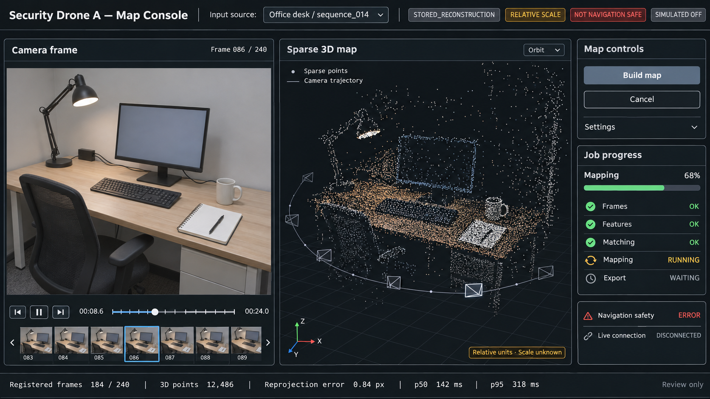

# Skywarden

**카메라 한 대로 만드는 희소 3D 지도와 사람 추적 콘솔 — 지상 검증 전용, 실기체 명령 0회.**

Skywarden은 스마트폰·웹캠·Tello EDU급 소형 드론의 단안 영상만으로 (1) 오프라인 희소 3D 지도(COLMAP sparse SfM)를 만들고, (2) 실제 사람 검출 모델과 Kalman 다중 추적기로 사람을 따라가며, (3) 그 결과를 yaw 전용 PID와 Tello SDK 2.0 Mock에 연결해 **비행 없이** 검증하는 로컬 macOS 프로젝트입니다. 모든 처리는 로컬 CPU에서 실행되며 외부 API나 업로드가 없습니다.

---

## 핵심 기능

| 영역 | 구현 내용 | 결과물 |
|---|---|---|
| 희소 3D 지도 | 영상 파일 또는 이미지 폴더 → 샷(컷) 검출·정지 카메라 판정 → 프레임 선별(블러·저질감·중복 제거, 컷을 넘는 매칭 없음; 기본은 고정 3 fps + 150 프레임 캡, 선택 옵션 `--selection adaptive`는 특징 추적 기반 적응형 선별로 캡 없이 연결 프레임을 추가 — 아래 "적응형 프레임 선별과 v3 trial 레이어" 절) → pycolmap SIFT/매칭 → **전역(global) 매퍼 기본**, `--mapper incremental` 선택 → 모델별 PLY + 카메라 궤적 + 보고서(`skywarden/map_report@2`). 보정 파일이 없으면 COLMAP이 SIMPLE_RADIAL 내부 파라미터를 추정. 작업 상태(`status`)와 별개로 **품질 판정** `quality.verdict` GOOD / PARTIAL / POOR을 고정 임계값(등록률 ≥ 0.6, 시간 커버리지 ≥ 0.7, 내부 공백 ≤ 2 s, 재투영 ≤ 1.5 px, 10 % 이상 모델 정확히 1개, 시간 정규화 궤적 점프 0, 점 ≥ 2,000)과 함께 기록. 여러 모델은 각자 좌표계로 따로 내보내며 절대 합치지 않음. 표시용 점 필터(`sparse_filtered.ply`: 삼각측량각 < 1.5°, 트랙 < 3, 재투영 > 2 × 중앙값 제거)는 원본 PLY를 바꾸지 않음 | `outputs/maps/<session>/{sparse.ply,sparse_filtered.ply,trajectory.json,map_report.json,coverage.json,shots.json,models/<i>/,log.txt}` |
| 검증된 밀집 점군 (CPU) | GOOD 지도의 포즈로 CPU 평면 스윕 MVS(ZNCC, 이웃 4개 중 상위 2개, 640 px) → 뷰마다 희소점 일치율 ≥ 0.70 **그리고** 다중 뷰 일관성 ≥ 0.30을 통과한 깊이만 융합 → `DENSE_VERIFIED (relative scale)`. PatchMatch(CUDA/HIP 전용)는 이 Mac에서 BLOCKED. Poisson 메시는 시각 검사 FAIL로 **실험 단계**, 콘솔 레이어 아님. 바닥 커버리지 실험(`docs/PLAN_DENSE_COVERAGE.md`)의 최종 변형 ESVFN2x25는 사전 등록된 선별 구간을 통과하지 못해 **미채택**이며, `dense_experimental/`에 `DENSE_EXPERIMENTAL (relative scale) - not adopted` 라벨로만 설치됨(아래 "밀집 점군 바닥 커버리지 실험" 절). 하늘과 사람을 제외한 **정적 장면 지도** 시도 두 가지 — `dense_static/`(마스크로 매칭 창 전체를 침식하는 첫 시도)와 `dense_static_v2/`(유효 픽셀 비용·경계 제외·전체 희소점 이웃 선택·정제된 비팽창 마스크) — 도 고정 비교 기준을 통과하지 못해 **미채택 trial 레이어**로만 설치됨(아래 "정적 장면 3D 지도" 절). 프레임 선별·깊이 이웃 실험의 세 변형(D12, F1b+D12, F1b)도 바닥·구조물 커버리지는 올렸지만 고정 오류 조항(자유공간 위반·하늘 점)을 넘지 못해 `dense_static_v3/`에 **미채택 trial**로만 설치됨(아래 "적응형 프레임 선별과 v3 trial 레이어" 절) | `outputs/maps/<session>/dense/{dense_report.json,dense_verified.ply}`, 실험 레이어 `outputs/maps/<session>/dense_experimental/{dense_report.json,dense_verified.ply}`, 정적 trial `outputs/maps/<session>/dense_static{,_v2,_v3}/{dense_report.json,dense_verified.ply}` |
| 단안 시각 주행거리계 (VO, 오프라인) | 저장된 영상에서 프레임 간 상대 포즈 추적. 모든 출력에 `kind=VO, scale=RELATIVE, loop_closure=false, relocalization=NOT_IMPLEMENTED, NOT_NAVIGATION_SAFE` 라벨. 컷·추적 실패 시 새 세그먼트(독립 좌표계, 연결하지 않음) | `packages/vision/vo.py`, `outputs/evidence/vo/` |
| 라이브 실행 (한 시간축) | 영상 파일을 **원래 시간 기준**(`--rate realtime`) 또는 최대 속도(`--rate max`)로, 혹은 `webcam:N`을 입력으로 받아 검출 → Kalman 추적 → 대상 선택 → MOCK yaw → VO를 한 워커에서 처리. 처리가 밀리면 오래된 프레임을 버리고 **세어서 기록**(1칸 버퍼). 두 시계를 분리 기록: `media_t`(영상 시간)와 `run_t`(벽시계). `control.json`(순번 `seq`)로 pause / resume / seek / stop / select / clear; seek마다 `epoch`이 늘고 추적기·선택기·제어기·VO 세그먼트가 초기화. 완료 판정은 파일 기반: `timeline.jsonl` 줄 수·SHA-256·프레임 매니페스트가 맞을 때만 `SUCCEEDED`, 워커가 죽으면 `INCOMPLETE`, SIGTERM은 `CANCELLED`. 끝난 실행은 Tracking 탭에서 `OPEN_LOOP_REPLAY`로 재생. `map_position=NOT_AVAILABLE`, `relocalization=NOT_IMPLEMENTED`, 명령 `MOCK`·미송신 | `outputs/runs/<session>/{timeline.jsonl,run_report.json,tracks.json,status.json,frames/}` |
| 지도 콘솔 | 표준 라이브러리 HTTP 서버(`127.0.0.1:8780`) + 캔버스 3D 뷰어. 저장된 지도 로드, 브라우저에서 빌드 시작/취소, 진행 단계, 라벨 배지(`STORED_RECONSTRUCTION`, `SCALE RELATIVE`, `NOT_NAVIGATION_SAFE` 등), **품질 배지 GOOD / PARTIAL / POOR / UNRATED(READY 제거)**, 모델 선택기("partial: model i of N"), 샷 변화·궤적 점프를 표시하는 커버리지 띠(점프를 가로질러 경로를 그리지 않음), 기하 레이어 선택(희소 원본 / 필터 / 검증 밀집 / **실험 밀집 — `Dense · experimental (not adopted)`, 해당 폴더가 있을 때만 활성, 경고색 `LAYER ▸ DENSE · EXPERIMENTAL · n pts in file` 칩과 미채택 사유 표시, 패널 제목 `Dense 3D map · experimental`** / 정적 trial `Dense · static scene (trial)`, `Dense · static scene v2 (trial)`, `Dense · static scene v3 (trial)` — 모두 해당 폴더가 있을 때만 활성, `NOT ADOPTED` 사유 칩 표시), 밀집 레이어는 경로·카메라를 기본 숨김(`P` / `C` 키 또는 Path / Cameras 토글로 복귀), 주 관측 영역 vs 전체 범위 프레이밍(`Full extent`, `Reset view`), `raw / filtered / dense verified / dense experimental / drawn` 점 수 | `apps/desktop/` |
| 사람 검출·추적 | YOLOX-nano ONNX(Apache-2.0)를 OpenCV DNN CPU로 실행(`source=REAL_MODEL`), 등속 Kalman 기반 `MultiTracker`: 마지막 **신뢰** 검출 후 2.0 s가 지난 트랙을 연관 **이전에** 만료, 게이트 = Mahalanobis χ² 9.21 **그리고** 픽셀 거리 ≤ 0.5 × 박스 높이, 확정 트랙은 게이트 그래프의 연결 성분으로 연관(트랙 1 : 검출 1만 신뢰, 그 외는 `AMBIGUOUS` — 보정·갱신 없음, 해당 검출은 보류), 잠정(TENTATIVE) 트랙만 남은 검출에 게이트된 Hungarian 적용. 한 명을 고르는 `TargetSelector`는 LOST 후 다시 선택하기 전까지 LOST 유지(자동 재선택 없음) | `outputs/tracks/<session>/{tracks.json,tracking_report.json,status.json,frames/}` |
| Tracking 탭 | 프레임 위 박스 오버레이, 트랙 목록에서 대상 선택, 대상 상태(LOCKED / PREDICTING / AMBIGUOUS / LOST) 타임라인, 기록된 트랙 위에서 계산한 **가상** yaw 명령(`MOCK`, 송신 안 함). AMBIGUOUS 프레임은 배지와 `STOP · TARGET_AMBIGUOUS`로 표시되며 yaw는 0 | 콘솔 `Tracking` 탭 |
| 제어 · Mock 기체 | yaw 전용 `YawController`(PID, 클램프, anti-windup, STOP 사유), Tello SDK 2.0 텍스트 프로토콜 파서, 루프백 UDP `MockTello`, 가상 경계 `GeofenceGuard` | `packages/control/`, `adapters/tello/` |
| 안전 게이트 | `TelloClient`는 `HARDWARE_ARMED=true` **그리고** `DRY_RUN=false`가 아니면 소켓을 열기 전에 `HardwareDisarmed`를 발생시킴. 모든 실행 스크립트가 `HARDWARE_ARMED=false DRY_RUN=true`를 강제 | `adapters/tello/client.py`, `tests/test_tello.py` |

## 안전 원칙

- **실기체 이륙·모터 명령·자동 추격 없음.** 모든 명령 트래픽은 루프백 UDP의 `MockTello`로만 갑니다. 테스트는 4가지 환경 변수 조합에서 비루프백 주소로의 송신이 0회임을 확인합니다.
- **단안 지도는 상대 스케일.** 모든 지도는 `scale=RELATIVE`, `NOT_NAVIGATION_SAFE`로 라벨됩니다. 미터 거리, 장애물 회피, 충돌 안전을 보장하지 않습니다. TUM 정답 궤적 대비 ATE는 평가용으로만 스케일을 빌려 계산했고 저장된 지도는 여전히 상대 스케일입니다.
- **박스 크기로 거리를 추정하지 않습니다.** 실험 E1에서 측정한 결과(아래 표) 때문에 이 규칙은 설계가 아니라 측정으로 뒷받침됩니다. lateral / forward / vertical 축 명령은 항상 0입니다.
- **신원 재식별(Re-ID) 없음.** 대상이 LOST되면 자동 재획득하지 않고 새 id가 부여됩니다. `TargetSelector`는 운영자가 다시 선택할 때까지 LOST를 유지하고, 같은 자리에 새 id가 나타나도 고르지 않습니다. 외모 특징을 저장하지 않습니다.
- **경합하면 정지.** 다른 사람의 검출이 대상의 게이트 안에 들어오면(또는 한 검출을 두 트랙이 다투면) 대상은 `AMBIGUOUS`가 되어 Kalman 보정도 생존 시간 연장도 받지 않고, `YawController`는 `TARGET_AMBIGUOUS`로 STOP합니다. 모션만으로는 두 사람을 구분할 수 없기 때문에 잘못된 LOCK 대신 정지를 택한 것이며, 그 대가로 교차 후 같은 id 재획득은 보장되지 않고 혼잡한 장면에서는 STOP 시간이 늘고 트랙이 짧아집니다(실험 E2, 아래 표).
- **합성 데이터와 실제 데이터 분리.** `SIMULATED` 결과는 실제 데이터 게이트 통과로 집계하지 않으며, 파이프라인은 합성 입력에 실제 라벨을 붙이는 것을 거부합니다.
- 콘솔은 `127.0.0.1`에만 바인드되고 `/api/health`의 `hardware_armed`는 항상 `false`입니다.

## 요구 사항

검증된 환경(`docs/ENV_AUDIT.md`): macOS 27.2 arm64, Apple M6, 16 GiB RAM. 다른 환경은 NOT_RUN입니다.

| 항목 | 버전 | 용도 |
|---|---|---|
| Python | 3.13.16 (`python3 -m venv .venv`) | 전부 |
| pycolmap | 4.2.1 (CPU SIFT, CUDA·dense MVS 없음) | 지도 |
| opencv-python-headless | 5.0.0.93 | 영상 읽기, ONNX 추론(`cv2.dnn`) |
| numpy / scipy / pytest | 2.5.4 / 1.18.1 / 9.2.0 | 추적기, 평가, 테스트 |
| Node.js | v24.21.0 (선택) | `tests/ui/ui_smoke.mjs`만 사용. `--browser`는 `/Applications/Dia.app`을 헤드리스로 띄우고, `--attach http://127.0.0.1:9222`는 사용자가 `--remote-debugging-port=9222`로 이미 연 Dia 창에 탭 하나를 열어 테스트 후 그 탭만 닫음 |
| ffmpeg | 9.0.2 (선택) | 영상 사전 변환용. 파이프라인 자체는 `cv2.VideoCapture`로 읽음 |

`colmap` CLI는 필요 없습니다. 모델 가중치(`data/models/yolox/*.onnx`)와 데이터셋(`data/public/*/`)은 git에 포함되지 않으며 아래 스크립트로 받습니다.

## 빠른 시작

```zsh
git clone <this repo> skywarden && cd skywarden

# 0) 프로젝트 전용 venv. 시스템 Python은 건드리지 않음
python3 -m venv .venv && .venv/bin/pip install -r requirements.txt

# 1) 사람 검출 가중치 (YOLOX-nano ONNX 3.66 MB, SHA-256 검증 후 data/models/yolox/ 에 저장)
scripts/fetch_models.sh yolox_nano

# 2) 로컬 콘솔: http://127.0.0.1:8780 (포트 충돌 시 --port <free port>)
scripts/run_demo.sh --check   # 경로와 HARDWARE_ARMED=false DRY_RUN=true 만 출력하고 종료
scripts/run_demo.sh

# 3) 영상 또는 이미지 폴더 -> 희소 3D 지도
scripts/build_sparse_map.sh assets/input/<clip>.mp4 --session my_room_01 --origin REAL_VIDEO
#    옵션: --camera-json FILE  --fps 3  --max-frames 150  --origin REAL_VIDEO|PUBLIC_DATASET|SYNTHETIC
#    적응형 프레임 선별(선택, 기본 아님): PYTHONPATH=packages .venv/bin/python -m mapping.cli build <clip> --session S --origin REAL_VIDEO \
#      --selection adaptive --selection-masks data/models/static/skywater_fp32.onnx [--force-frames 240 900 ...] [--max-frames 260]

# 4) 저장된 지도 요약 출력 (콘솔의 "Stored maps" 에서도 로드 가능)
scripts/replay_map.sh outputs/maps/my_room_01

# 5) 녹화 영상 -> YOLOX-nano(CPU) -> Kalman 다중 추적 (드론 명령 생성 없음)
scripts/run_tracking.sh assets/input/<clip>.mp4 my_people_01 --origin REAL_VIDEO
#    옵션: --model yolox_nano  --fps 10  --max-frames 600  --score-thr 0.35

# 6) SIMULATED 폐루프 약 20 s: 합성 검출기 -> Kalman -> yaw PID -> MockTello (루프백 UDP)
scripts/run_tracking_sim.sh

# 7) 라이브 실행: 영상을 원래 시간 기준으로(또는 webcam:0) 검출+추적+MOCK yaw+VO 한 시간축에 기록 (콘솔 Live 탭과 동일)
PYTHONPATH=packages .venv/bin/python -m vision.live_run assets/input/<clip>.mp4 --session live_01 --rate realtime --max-seconds 30
#    옵션: --rate realtime|max  --max-seconds S  --no-vo  --fx F | --calib camera.json  --vo-width 640  --runs-root outputs/runs
#    실행 중 제어: outputs/runs/live_01/control.json 에 {"seq": n, "op": "pause|resume|seek|stop|select|clear", "args": {...}} 를 원자적으로 기록
PYTHONPATH=packages .venv/bin/python -m vision.live_run --verify outputs/runs/live_01   # 줄 수·SHA-256·프레임 검증만 수행

# 8) 자동 테스트 (원시 로그를 outputs/evidence/tests/ 에 남김) / 헤드리스 UI 테스트
scripts/test_all.sh
node tests/ui/ui_smoke.mjs
```

촬영 팁(지도용): 움직이는 사람·물체가 없는 정적인 실내, 제자리 회전이 아니라 **옆으로 천천히 이동**, 질감 많은 벽·가구, 밝은 조명, 30–90초, 1080p 이하. 고정 카메라 영상은 베이스라인이 없어 지도가 만들어지지 않으며, 이 경우 `map_report.json`의 `failure.message`에 다음 조치가 적힙니다.

## 콘솔 사용법



위 이미지는 UI 작성 전에 만든 **레이아웃 목업**입니다(`docs/DESIGN_ASSETS.md`). 실제 콘솔은 같은 분할(카메라 프레임 | 3D 지도 | 우측 제어 열)을 따르되, 배지와 수치는 전부 `map_report.json` / `tracking_report.json`에서 읽습니다.

**Mapping 탭** — 입력 선택 후 `Build map`으로 빌드(단계: Frames → Features → Matching → Mapping → Export, 취소 가능), `Stored maps`에서 저장된 세션 로드. 프레임 스크러버를 움직이면 궤적과 점군이 그 시점까지 그려집니다. 하단 상태 줄에 등록 프레임 수, 3D 점 수, 재투영 오차, 렌더 시간이 표시됩니다.

**Tracking 탭** — 입력과 검출기(로컬에서 해시가 확인된 모델만 목록에 뜸)를 고르고 `Run tracking`. 완료된 실행은 `Recorded runs`에서 재생합니다. 프레임 위 박스(대상 강조, PREDICTING 점선, TENTATIVE 점박이, 원시 검출 토글), 트랙 목록, 대상 상태 배지, 가상 yaw 바와 STOP 사유, 상태별 색 타임라인이 표시됩니다. 대상 선택은 **개루프 재생**입니다: 녹화 카메라는 돌지 않았으므로 yaw 값은 `MOCK · NOT SENT`로만 표시됩니다. 끝난 라이브 실행도 이 목록에 `LIVE RUN · OPEN_LOOP_REPLAY`로 올라옵니다. 지도 빌드·추적 실행·라이브 실행은 한 번에 하나만 가능합니다(409).

**Live 탭** — 입력(영상 파일 또는 `webcam:N`), 속도(원래 시간 기준 / 최대 속도), 최대 초(기본 30)를 고르고 `Start`. 워커는 매 프레임을 검출 → 추적 → 대상 선택 → MOCK yaw → VO로 처리해 `timeline.jsonl`에 기록하고, 콘솔은 250 ms마다 `status.json`과 `frames/latest.jpg`를 읽어 최신 프레임과 박스를 그립니다. 상단 배지는 `LIVE / PAUSED / STALLED / STALE_DATA / DISCONNECTED / SUCCEEDED / FAILED / INCOMPLETE / CANCELLED`, 하단 상태 줄은 처리 fps · 지연 p95 · 버린 프레임 수 · epoch · 데이터 나이입니다. **확정(LOCKED) 박스를 클릭**하면 대상이 되고(`SELECT` 이벤트), LOST 뒤에는 다시 골라야 합니다(자동 재선택 없음). `Pause`/`Resume`/시크 슬라이더(파일만)/`Stop`은 `control.json`을 거쳐 워커에 전달되며, seek는 추적기·선택기·제어기·VO 세그먼트를 초기화합니다. "Camera pose (VO)" 패널은 **현재 세그먼트의 상대 스케일 경로**일 뿐 지도가 아니며 `Map position: NOT_AVAILABLE`로 표시됩니다. yaw는 라이브 파이프라인이 계산한 `MOCK` 값이고 송신되지 않습니다. `Stop`으로 끝낸 실행은 파일 검증 후 `SUCCEEDED (STOP_REQUESTED)`가 되고 Tracking 탭의 `Recorded runs`에서 재생할 수 있습니다.

| 키 | 동작 |
|---|---|
| `M` / `T` / `L` | Mapping / Tracking / Live 탭 전환(URL 해시 `#tracking` 유지) |
| `Space`, `←` / `→` | 재생·일시정지, 한 프레임 이동 (Live 탭에서는 `Space`가 워커에 pause/resume 전달) |
| `R`, `+` / `-`, `G` | (Mapping) 뷰 리셋, 줌, 지도 성장 모드 토글 |
| `1`–`9`, `0`, 박스 클릭 | (Tracking) n번째 트랙을 대상으로 선택, 대상 해제, 클릭 선택. (Live) LOCKED 박스 클릭으로만 선택, `Clear target` 버튼으로 해제 |
| `Esc` | 취소 확인 창 닫기 |

## 프로젝트 구조

```
apps/desktop/            # server.py (stdlib HTTP, 127.0.0.1:8780) + static/{index.html,app.js,tracking.js,live.js,viewer.js,app.css}
packages/
  mapping/               # frame_source, frame_selection(기본 고정 3 fps; `--selection adaptive`: 10 fps 후보를 하늘·사람 마스크 적용 특징 추적으로 검사해 겹침 0.6 / 시차 8 px / 흐름 40 px / 저속 3 px / 최대 공백 2 s 규칙으로 선별, 강제 프레임, `selection.json`), shots(컷·정지 카메라 검출), sparse_pipeline(pycolmap, 전역/증분 매퍼), quality(판정·임계값), export(모델별 PLY/trajectory, 점 필터), diagnose(구간 진단), dense(CPU 평면 스윕 MVS + 검증, 기본 레이어), dense_cpu(커버리지 실험용 변형: `--sweep fronto+ground --verify multi --voxel-near-scale --neighbour-rule`; `--neighbour-rule median_then_near_far` = 원거리 표면 이웃(D1), `--coarse-ground` = 지평선 아래 지면 행 반해상도 스윕(D2, 크롭 전후 결과 동일성 테스트)), dense_eval(구간별 커버리지·오류 측정 하네스), static_masks(하늘·사람 keep 마스크 생성: `--dilate`, `--refine-sky`), static_eval(정적 지도 판정 하네스: 공통·중립 깊이맵 판정, 하늘·사람·경계 띠·줄무늬 지표, 정적 픽셀·지면 위 커버리지), openmvs_compare(별도 프로세스로 실행하는 OpenMVS 비교 래퍼), regions/regions_sumida.json·regions_sumida_v2.json·regions_sumida_v3.json·regions_fsc_v1.json(고정 평가 폴리곤; v2는 보류 프레임 2개와 wall 클래스 추가, v3는 빠른 회전 프레임 2개 추가, fsc_v1은 FSC 3 프레임 floor / structure / far), evaluate(ATE), replay, labels, cli(build / rate)
  vision/                # person_detector(YoloxDetector), track_video(offline job), bbox_distance_eval(E1), vo(단안 VO), live_source(FileSource realtime|max, WebcamSource, 1칸 LatestFrameBuffer), live_run(한 시간축 워커: timeline.jsonl / status.json / run_report.json / tracks.json, control.json, --verify)
  tracking/              # tracker: Detection, MultiTracker(Kalman, 만료 우선, 게이트 그래프 성분 연관 + AMBIGUOUS, 잠정 트랙만 Hungarian), TargetSelector(sticky LOST)
  control/               # yaw_controller(PID, SafetyLimits, DroneCommand), virtual_replay, geofence(Geofence, GeofenceGuard)
  sim/                   # synthetic_scene, tracking_scenario(SIMULATED 폐루프), two_person_crossing(E2), geofence_scenario(E3)
adapters/tello/          # protocol(SDK 2.0 텍스트), client(TelloClient + HardwareDisarmed 게이트), mock_tello(MockTello, 루프백 UDP)
scripts/                 # run_demo.sh, build_sparse_map.sh, replay_map.sh, run_tracking.sh, run_tracking_sim.sh, fetch_models.sh, test_all.sh
tests/                   # pytest 18개 모듈(131 tests; test_live_run 11, test_quality 8, test_dense 7, test_export_geometry 3, test_vo 3 포함) + ui/ui_smoke.mjs(84 checks)
data/public/<set>/SOURCE.md   # 데이터셋 출처·라이선스·SHA-256 (데이터 자체는 git 제외)
data/models/yolox/SOURCE.md   # 가중치 출처·SHA-256 (가중치는 git 제외)
assets/input/            # 사용자 본인 영상을 두는 곳 (git 제외)
assets/design/           # 레이아웃 목업 이미지 (결과 아님)
outputs/                 # maps/, tracks/, runs/(라이브 실행), evidence/ — 실행 산출물 (git 제외)
docs/                    # 설계·계획·검증 기록
```

서버 API: `GET /api/health`, `/api/inputs`, `/api/sessions[/<id>[/files/*]]`, `/api/models`, `/api/tracks[/<id>[/files/*]]`, `/api/runs`, `/api/runs/<id>`(상태 + 완료 검증, 워커가 죽었으면 `INCOMPLETE`), `/api/runs/<id>/latest`, `/api/runs/<id>/vo`, `/api/runs/<id>/files/{timeline.jsonl,run_report.json,tracks.json,frames/latest.jpg,frames/fNNNNNN.jpg}`; `POST /api/jobs`, `/api/jobs/<id>/cancel`, `/api/track-jobs`, `/api/track-jobs/<id>/cancel`, `/api/tracks/<id>/control`, `/api/run-jobs`(`{input_id | "webcam:N", rate, session}`, 202), `/api/run-jobs/<id>/cancel`(SIGTERM → `CANCELLED`), `/api/runs/<id>/control`(`{op, args}` → `control.json`에 순번 부여, 202; 실행 중이 아니면 409, 모르는 op는 400), `/api/runs/<id>/replay`(끝난 실행의 `tracks.json`을 `OPEN_LOOP_REPLAY`로). 지도 빌드·추적·라이브 실행은 통틀어 한 번에 하나(409). 세션 id로 `.`/`..`는 거부되고 파일 경로는 허용 목록으로 제한되며, 라이브 입력은 입력 목록의 id 또는 `webcam:N` 문자열만 받습니다.

## 검증 결과

전 행이 이 Mac에서 실제 실행된 명령과 원시 산출물(`outputs/evidence/`, `outputs/maps/`, `outputs/tracks/`)에 근거합니다. 전체 명령·버전·경로는 `docs/VALIDATION_LOG.md`, 실패와 후속 조치는 `docs/FAILURES.md`에 있습니다. 상태 어휘는 PASS / FAIL / BLOCKED / NOT_RUN 네 가지만 씁니다.

| 항목 | 입력 (라벨) | 상태 | 핵심 수치 |
|---|---|---|---|
| 희소 지도, OPENCV 4계수 보정 | TUM fr1/desk, 613 → 53 프레임 (PUBLIC_DATASET) | PASS | 49/53 등록(92.5 %), 4,297점, 재투영 0.831 px, 약 5 s. ATE RMSE 2.05 cm(Sim(3), 정답 스케일 차용, 평가 전용) |
| 희소 지도, 보정 없이 추정 | 동일 | PASS | 48/53 등록, 3,987점, 0.665 px, ATE 1.86 cm |
| 희소 지도, 공식 FULL_OPENCV 5계수 보정 | 동일 | FAIL | 초기 이미지 쌍 생성 실패. 원인 미확인(F-01), 위 두 경로로 복구 |
| 희소 지도, 편집된 공원 산책 영상 60 s (방콕), **기준선** | CC BY YouTube 클립 (PUBLIC_DATASET) | PASS (빌드); 오프라인 품질 판정 **PARTIAL** | 49/150 등록(0.327), 10,814점, 0.848 px, 약 5.9 min. 4개 모델(49/16/12/8), 시간 커버리지 0.302, 궤적 점프 13회(25.3–37.3 s). 60 s 구간에 컷 18개 — 최대 모델이 여러 컷을 가로질러 이어진 것으로 보임(추론) — `outputs/evidence/map_quality/baseline_bangkok_60s/` |
| 희소 지도, 같은 방콕 영상, 컷 존중 매칭 후 | 동일, `--max-frames 300` | PASS (빌드); 판정 **POOR** (개선 없음) | 증분 매퍼: 176 프레임 중 최대 모델 12(0.068), 모델 4개가 각각 한 샷 안, 점프 0. 전역 매퍼: 모델 14개, 최대 15/176(0.085). 컷을 넘는 연결이 사라지며 점프는 0이 됐지만 커버리지는 0.327 → 0.068. 컷 18개짜리 편집 영상은 지도 한 장이 되지 않음(기록만, 수정 없음) |
| 희소 지도, 강변 산책 한 테이크 60 s (스미다) | CC BY YouTube 클립, 컷 0 (PUBLIC_DATASET) | PASS, 판정 **GOOD** (증분·전역 모두) | 증분: 150/150 등록, 33,904점(필터 27,524), 0.454 px, 점프 0, MAP 38.5 s. 전역: 150/150, 37,430점(필터 28,559), 0.512 px, 점프 0, MAP 93.2 s. 두 매퍼 경로 일치(Sim(3), 150 포즈): RMSE 경로 길이의 1.75 %, 마지막 프레임(59.7 s)에서 최대 10.28 % — 정답이 없어 어느 쪽이 맞는지는 미결 (`outputs/evidence/geometry/sumida_global_vs_incremental.json`) |
| 희소 지도, 캠퍼스 항공 촬영 71 s (FSC) | CC BY YouTube 클립, 컷 0 (PUBLIC_DATASET) | 증분 **PARTIAL** → 전역 **GOOD** | 증분: 150/150, 99,293점, 0.837 px, 59.7–70.7 s에 시간 정규화 점프 **23회**, MAP 271.8 s. 전역: 150/150, 96,344점, 0.708 px, 점프 **0**, MAP 116.7 s. 증분 지도의 59.7–71 s 구간 카메라 속도는 클립 중앙값의 10.3×(그 전 0.97–1.06×)인데 같은 구간의 영상 흐름은 0.34–0.41 px/frame로 앞부분(0.43–1.18)보다 작음; 전역 매퍼는 1.04× (`outputs/evidence/geometry/fsc_late_stretch_speed.json`). 증분 드리프트의 원인은 미확인. 전역 지도에서 야구장이 형태를 유지(`views/fsc_global_topview.jpg`, 이미지 관찰) |
| 희소 지도, 사람을 따라가는 드론 영상 60 s (위트레흐트), 5 fps | CC BY YouTube 클립 (PUBLIC_DATASET) | PASS (빌드); **PARTIAL** (두 매퍼 모두, 미해결) | 증분: 모델 2개 216 + 37 / 298. 전역: 한 모델 298/298, 81,007점, 0.517 px이나 점프 43회(0.4–7.2 s 구간 6–12배 늘어남, 44.6–45.8 s·50.3–51.1 s 급등). 피사체가 화면을 크게 차지하는 영상. 사람 박스 마스킹 실험(`outputs/experiments/utrecht_global_masked/`, 마스크 픽셀 중앙값 20.6 %): 점프 43 → 38, 50.3–51 s 급등 소멸, 44.6–45.6 s 급등 215× → 77×, 시작 구간은 그대로, 여전히 PARTIAL — 스미다·FSC 회귀 가드를 마스킹과 함께 돌리지 않아 **미채택**(F-11) |
| 희소 지도, 고정 카메라 거리 영상 (몬트리올) | CC BY YouTube 클립 (PUBLIC_DATASET) | FAIL (예상된 실패; 측정 근거 있는 거부) | "camera is static (median flow 0.006 px/frame < 0.1) for 100% of the input" — COLMAP 실행 전에 정지 카메라로 판정해 거부, 추적용으로 안내 |
| 프레임 간격 가드 (첫 버전) | 방콕·위트레흐트 3개 세션 | **FAIL** → 가드 축소 | 1.0 s 초과 간격을 모두 치명 처리해 1.33 / 1.335 / 1.001 s 간격의 입력을 거부(정답 있는 TUM fr1/desk도 거부, 구현자 기록). 이제 150 프레임 캡이 간격의 원인일 때만 치명(F-07) |
| TUM fr1/desk, 증분 vs 전역 매퍼, 정답 궤적 대비 | PUBLIC_DATASET, OPENCV 4계수 | PASS | 증분 49 포즈 ATE RMSE 2.05 cm / 최대 6.81 cm; **전역 53/53 포즈 1.66 cm / 5.01 cm**, 4,351점, 0.650 px. Sim(3) 스케일은 평가용으로만 차용 — `outputs/evidence/geometry/global_vs_incremental_tum_ate.json` |
| 내보내기·표시 vs 복원 오류 분리 | 스미다·FSC·TUM 세션 3개 | PASS (결함은 복원 단계) | 내보낸 포즈·점을 COLMAP 투영과 재비교: 최대 차이 0.0078 / 0.0136 / 0.00008 px, 카메라 뒤 점 0, 포즈 순서 = 시간 순서 — `outputs/evidence/geometry/verify_export_*.json` |
| 구간별 LOW_CONFIDENCE 검출기 (5 s 창) | 스미다·FSC 증분 지도 | **FAIL** (구분하지 못함; 보고만, 조정 안 함) | 사전 기대: 스미다 0개, FSC 59.7–70.4 s 창에 플래그. 관측: 스미다 23개 중 9개 플래그, FSC 28개 중 0개. 드리프트 원인은 이 검출기로 확인되지 않음(F-08) |
| 검증된 밀집 점군, 스미다 (전역 포즈) | GOOD 지도 | PASS (수용 기준 3개 모두 충족) | 참조 뷰 117개 중 108개 VERIFIED, 융합 917,498점(덮인 뷰 희소점 36,470의 25배), 58.6 s. v1(경계 깊이 미제거) 104 뷰 / 1,120,031점 보존. 카메라 바로 앞 보도는 대부분 비어 있음 — `outputs/maps/mqg_sumida_0025_0125/dense/` |
| 검증된 밀집 점군, FSC (전역 포즈) | GOOD 지도 | PASS | 145/145 뷰 VERIFIED, 1,942,876점(희소의 20배), 76.8 s — `outputs/maps/mqg_fsc_campus_aerial/dense/` |
| 밀집 수용 기준, 합성 방 (정답 표면 있음) | 생성기 8 뷰 (SIMULATED) | 실행 PASS; 수용 **FAIL** 3/8 (정의상) | 밀집점의 실제 표면까지 거리 p50 0.0095, 97.8 %가 0.05 룸 단위 이내(희소 p50 0.0035). 고정된 일관성 비율이 겹치지 않는 픽셀을 분모에 넣어 FAIL; 정의는 바꾸지 않음 |
| PatchMatch 밀집 스테레오 | pycolmap 4.2.1 | BLOCKED | "requires CUDA or HIP" — 이 Mac에서 재시도 없음 (`outputs/evidence/dense/patch_match_probe.txt`) |
| Poisson 메시 (검증 밀집점 기반) | 스미다·FSC | 실험 단계; 시각 검사 **FAIL** | FSC: 지붕·나무는 보이나 화면 중심으로 모이는 방사형 줄무늬(원인 미확인); 스미다: 나무 몇 그루만. 콘솔 레이어로 제공하지 않음(F-09) |
| 단안 VO (오프라인) | 합성 방 / 스미다·방콕·몬트리올 0–60 s | 기준 6개 PASS, **1개 FAIL** | 합성 ATE 1.82 %(≤ 5 %), 순수 회전 yaw 19.995° vs 20°, 컷 → 새 세그먼트, 방콕 컷 재현율 16/18 = 0.889, 몬트리올 삼각대 TRACKING 0 %, p50 2.6–4.8 ms/frame PASS. **스미다 vs SfM 궤적 23.3 %(≤ 15 %) FAIL**(초점거리 추정 0.9 × 폭); SfM 초점거리를 빌리면 2.56 %이나 독립 증거 아님(F-10) — `outputs/evidence/vo/` |
| 희소 지도, 합성 방 | 생성기 8프레임 (SIMULATED) | PASS (파이프라인 점검용) | 8/8 등록, 3,845점, 0.084 px, ATE 0.5 mm. 실제 데이터 게이트에 집계하지 않음 |
| 라이브 실행, 사람을 따라가는 드론 영상 1080p, 원래 시간 기준 30 s (위트레흐트) | CC BY YouTube 클립 (REAL_MODEL / PUBLIC_DATASET), 스크립트가 운영자 역할로 select | PASS (사전 기준 7/7); 대상 LOCKED는 프레임의 17 %뿐 | 처리 29.96 fps(기준 ≥ 8), 지연 p50 19.5 / p95 24.2 ms(기준 ≤ 250), 캡처 900 · 처리 899 · 버림 1(= 캡처 − 처리), 프레임 파일 899 = 프레임 행, 908행·SHA-256 검증 `SUCCEEDED`. 검출 9.8/11.4 ms, VO 5.0/8.7 ms. 대상 상태 LOCKED 155 / PREDICTING 576 / AMBIGUOUS 74 / LOST 82 / SEARCHING 12 (899 프레임 행), LOST 뒤 재선택 6회(select 7회 적용, 적용 지연 p50 60.5 / 최대 86.4 ms). MOCK yaw −40(한계)…+12, 149행, LOCKED 아닐 때 yaw ≠ 0 **0회**, 미송신. VO 세그먼트 2개(5.0 s에 기하 검증 실패로 분할), 포즈 없는 구간 2개 기록, 초점거리 추정(UNCALIBRATED)이라 경로는 상대·미검증. 재생 `OPEN_LOOP_REPLAY`, `nonzero_yaw_while_not_locked 0` — `outputs/evidence/live/t7_utrecht_realtime_30s.json` |
| 라이브 실행, 같은 구간 최대 속도 | 동일, 선택 없음 | PASS (실행) | 47.78 fps, 902 캡처 / 901 처리 / 1 버림, 30.03 s 영상을 18.93 s에 처리, 전 구간 SEARCHING(yaw 0). 지연 p50 61.5 / p95 68.7 ms는 프레임을 즉시 넘기는 모드라 실시간 수치와 비교 불가 — `utrecht_max_30s.json` |
| 라이브 실행, 실시간 페이싱·일시정지·시크·정지 (vtest.avi 10 fps) | 개발용 클립 | PASS | 10 s 영상 → 10.044 s 실행(±0.5 s 이내), `media_t` 단조 증가. 일시정지 2.07 s 동안 프레임 행 0 · PAUSED 하트비트 4행 · `media_now` 고정(2.0794), 재개 후 2.0 → 2.1 s 이어짐. 제어 적용 지연 pause 53.8 / resume 58.1 / 모르는 op 81.8(`CONTROL_IGNORED`) / seek 115.8 / stop 69.1 ms. seek 3.27 → 40 s: epoch 0 → 1, 트랙 비움, SEARCHING, VO 세그먼트 1 항등 포즈. stop → `SUCCEEDED (STOP_REQUESTED)` — `t2_vtest_realtime_pacing_10s.json`, `t2_t3_vtest_transport.json` |
| 라이브 실행, 안전·지속성 | 스텁 파이프라인 / SIGKILL / SIGTERM / 파일 변조 (`tests/test_live_run.py` 11개, `tests/test_server.py` 1개) | PASS | AMBIGUOUS·PREDICTING·LOST·입력 정지 0.5 s·일시정지 구간 모두 yaw 0 + 사유, LOST는 select 전까지 유지. SIGKILL → `INCOMPLETE`(마지막 fsync까지 읽힘), SIGTERM → `CANCELLED`(부분 파일 보존), 완료 후 `timeline.jsonl`에 한 줄 추가 → API가 `INCOMPLETE`로 전환. 1칸 버퍼 `dropped == captured − processed` 정확 |
| 라이브 실행, `webcam:0` (카메라 없는 Mac) | `system_profiler` 카메라 목록 비어 있음 | PASS (무장치 분기); 실제 웹캠 **NOT_RUN** | 0.285 s 만에 `FAILED` / `OPEN_SOURCE` / `NO_DEVICE`(기준 5 s 이내), 부분 SUCCEEDED 없음 — `t6_webcam0_no_device.json`. 물리 카메라가 없어 실제 웹캠 측정은 수행하지 못함 |
| **본인 영상 지도·추적 (REAL_VIDEO)** | `assets/input/` | **NOT_RUN** | `.gitkeep`만 존재. 위 공개 클립은 타인 영상이라 이 게이트를 닫지 못함 |
| 사람 추적, 주 증거 | TUM fr3/walking_xyz 859 → 287 프레임 (REAL_MODEL / PUBLIC_DATASET) | PASS | 검출 p50/p95 8.94/10.45 ms, 109.5 fps(검출+추적), 349 검출, 트랙 33개 중 24개 확정, MOTA/IDF1 미정의 |
| 사람 추적, 스트레스 클립 | OpenCV `vtest.avi` 600 프레임 | PASS | 105.0 fps, 3,856 검출, 39개 중 23개 확정, 확정 지속 p50 13.0 s / 최대 52.1 s |
| 사람 추적, 혼잡한 거리 | CC BY YouTube 클립 1,390 프레임 | PASS | 90.6 fps, 10,916 검출, 438개 중 222개 확정, Re-ID가 없어 189 new ids/min |
| SIMULATED 폐루프 | 합성 검출기 → Kalman → yaw PID → MockTello | PASS | 300 프레임/20 s, 15.04 Hz, 처리 0.108/0.18 ms p50/p95, 중심 오차 106.4 → 21.3 px, 0.5/1.5 s 가림 재획득, 2.5 s 가림 → LOST, LOCKED 아닐 때 yaw 0회, rc 패킷 301건 모두 Mock |
| E1 박스 크기로 거리 추정이 쓸 만한가 | 위 TUM 검출 329건 vs 등록된 Kinect 깊이 0.94–9.33 m | 실행 PASS, **판정 FAIL** | 키 1.70 m 가정: 상대 오차 p50 43 % / p95 90 %. 첫 20 %로 보정(1.387 m): p50 26 % / p95 61 %, 절대 오차 p50 0.43 m / p95 1.16 m. 사전 기준 p95 ≤ 25 % 미달 |
| E2 가림 중 다른 사람이 지나가면 대상 id가 유지되는가 — **수정 전 추적기** (보존된 기준선) | 합성 검출 700회(50 seed × 7 가림 × B 유무) (SIMULATED) | 실행 PASS, **판정 FAIL** (K1 PASS, K2 FAIL, K3 FAIL) | K1 0.5/1.5 s 가림 후 같은 id 재획득 100 %. K2 2.5 s 가림 후 LOST 10 %(기준 100 %): B의 검출이 coasting 트랙을 연장. K3 대상 id가 B 위에 LOCKED된 프레임이 있는 실행 158/350(기준 0). 같은 추적기로 측정한 제어 경로: A가 숨은 동안 LOCKED 162/167 프레임, B를 향한 yaw ≠ 0 100/167 프레임(중앙/오프센터 교차) — `outputs/evidence/e2_two_person_baseline_v1{,_control}/` |
| E2 재실행 — **수정 후 추적기** (만료 우선 + 게이트 그래프 AMBIGUOUS + 픽셀 게이트, fix_v3) | 동일 700회, 동일 seed·기준 K1–K3 (SIMULATED) | **PASS** (K1 PASS, K2 PASS, K3 PASS) | K1 100/100 %, K2 LOST 100 %, K3 0/350. 같은 행 민감도 0.5/1.0/1.5 s: 같은 id 100 %, 전환 0. 제어 경로(실제 `YawController`, 가상 텔레메트리, 소켓 없음): B를 향한 yaw ≠ 0 0/0, A가 숨은 동안 yaw ≠ 0 0/0·LOCKED 0/0, LOCKED 아닐 때 yaw ≠ 0 0(수정 전후 동일); AMBIGUOUS 프레임 3,548/58,044(중앙) · 3,550/29,022(오프센터). 중간 버전 fix_v2(픽셀 게이트 없음)는 K1 1.5 s 44 %로 FAIL — `docs/FAILURES.md` F-05 |
| 수정 후 추적기, 실제 클립 재추적 (같은 검출 재사용) | TUM walking / `vtest.avi` / 몬트리올 거리 (REAL_MODEL / PUBLIC_DATASET) | PASS (실행; 정확도 지표 아님) | id 33→34 / 39→56 / 438→680, 프레임당 LOCKED 1.01→0.84 / 6.32→4.74 / 7.33→4.41, AMBIGUOUS 트랙이 있는 프레임 50/287 · 369/600 · 987/1,390, vtest 확정 지속 p50 13.0→3.65 s. 혼잡할수록 STOP이 늘고 트랙이 짧아지는 의도된 대가 |
| E4 옷 색으로 두 사람을 구분할 수 있는가 (얼굴·생체 식별은 처음부터 제외; 머리 영역 미사용, 메모리 전용 HSV 히스토그램, Hellinger 거리) | fix_v3 재추적 3개 클립의 LOCKED 트랙 의사 라벨 (REAL_MODEL / PUBLIC_DATASET, 정답 신원 없음) | 실행 PASS, **판정 NO_GO** (vtest FAIL, 거리 FAIL, TUM BLOCKED) | 사전 기준 TPR ≥ 0.60 @ FPR ≤ 1 % 를 2개 클립 이상. vtest AUC 0.870, TPR@1 % 0.154(871/2,484쌍); 몬트리올 거리 AUC 0.874, TPR@1 % 0.493(5,083/5,756쌍); TUM AUC 0.963이나 음성 쌍 55개(< 200)로 BLOCKED. 1 % 오매칭에서 진짜 매칭의 15–49 %만 회수 → 추적기에 통합하지 않음, AMBIGUOUS → STOP 유지 — `outputs/evidence/e4_appearance/` |
| E3 가상 경계에서 이동을 멈추는가 | MockTello 운동학 토이, 10 × 10 m, 여유 1 m (SIMULATED_FRAME_ONLY) | PASS (추적기 수정 후 재실행도 PASS) | 사전 6개 체크 모두 참. 보호 시 최소 거리 경계 안쪽 1.175 m(여유 구간 미진입), 비보호 대조군은 0.485 m 침범, 포즈 끊김 3–4 s 동안 `NO_POSE_FOR_GEOFENCE` 정지 10회·이동 0, 비루프백 패킷 0. 재실행 `outputs/evidence/e3_geofence_after_tracker_fix/`: 6개 체크·거리 수치 동일, 10 Hz 루프 지터로 차단 프레임 수만 1프레임 차이(42→43) |
| 밀집 점군 바닥 커버리지 실험, 스미다 (3 프레임 고정 폴리곤) | GOOD 전역 지도의 포즈, 카메라 포즈 불변 | **기본 레이어 M0 유지; 최종 변형 ESVFN2x25 NOT_ADOPTED** (실험 레이어로만 설치) | 바닥 `cov1px`(640 px, 1 px 점) M0 0.0244 / 0.0024 / 0.2764 → ESVFN2x25 0.2789 / 0.119 / 0.6714(+25.4 / +11.7 / +39.5 pp), 구조물 모두 상승, `inconsist` 0.151 → 0.1165, `float_knn` 0.138 → 0.096, `float_fs` 0.485 → 0.369, 135.1 s(예산 176 s) — 전체 클립과 FSC(149/149 뷰, 6,520,886점, `inconsist` 0.0638 → 0.0444, 155 s)에서 2절 기준 전부 충족. 그러나 사전 등록된 선별 구간 t 26–34 s에서 `float_fs` 0.151 → 0.263(허용 +2 pp)으로 FAIL → 규칙대로 미채택. 상세는 아래 절과 `docs/PLAN_DENSE_COVERAGE.md` 10절 |
| 정적 장면 3D 지도, 스미다 (5 프레임 고정 폴리곤: 조정 3 + 보류 2, 하늘·사람 제외) | GOOD 전역 지도의 포즈, 카메라 포즈 불변 | **기본 레이어 M0 유지; 최종 변형 S3r40 FAIL vs B1 → `dense_static_v2/` trial로만 설치(NOT_ADOPTED)** | 첫 정적 시도 B2(`dense_static/`)는 바이트 동일 재현. B2는 마스크가 7×7 매칭 창 전체를 침식해 하늘 경계 20 px 띠의 구조물 커버리지가 B1 0.74–0.95 → 0.28–0.66으로 떨어졌고, 마스크로 걸러진 희소점이 이웃 선택을 바꿨음(26개 중 15개 뷰). S3r40(유효 픽셀 ZNCC ≥ 40 %, 경계 제외, 전체 희소점 이웃, 정제 비팽창 마스크): 띠 0.63–0.88로 회복, 구조물 전 프레임 +4.9~+7.3 pp, 8 s 바닥 줄무늬 제거(기준 열 대비 0.17 vs 0.19; B1 0.88 vs 0.30), 오류 지표 동일(`float_fs` 중립 0.355, `inconsist` 0.110), 1,530,092점, 221.3 s. 그러나 B1 대비 구조물 −3.1 / −4.0 / −6.7 pp(3 프레임), 벽 −11.6 / −9.3 pp, 띠 −2.5~−23.7 pp, 하늘 오탐 1.4–6.8 %(기준 0.5 %), 중립 `float_fs` 0.355 > 0.338, 221 s > 203 s → 고정 비교 **FAIL**. OpenMVS(별도 CLI, AGPL-3.0)는 구간 바닥 0.385(B1 0.252)로 더 낫고 깨끗하나 구조물 0.118, 기본 해상도 800 px는 segfault로 BLOCKED. 상세는 아래 "정적 장면 3D 지도" 절과 `docs/PLAN_STATIC_MAP.md` Result |
| 적응형 프레임 선별(F1b)과 깊이 이웃 변경(D1 / D2), 스미다·FSC·위트레흐트 (7 + 3 프레임 고정 폴리곤, 기준 V2 = S3r40) | 같은 CC BY 클립 3개 (PUBLIC_DATASET) | **경로: F1b PASS(3개 클립); 밀집: 모든 변경 FAIL(고정 오류 조항) → 기본 선별·기본 레이어 유지, `dense_static_v3/` trial 3개(NOT ADOPTED)** | 경로: 스미다 최대 공백 0.67 → 0.33 s·재투영 0.512 → 0.46 px(150 → 190 프레임), FSC 0.67 → 0.33 s(150 → 213), 위트레흐트 점프 43 → 19·첫 10 s 34 → 0(298 → 343, 여전히 PARTIAL). F1(시차·흐름 키프레임만)은 92 프레임으로 SfM 전에 기각. 밀집(스미다 전체, 바닥 `cov1px` 조정 3 프레임): V2 0.237 / 0.121 / 0.682 → D12 0.263 / 0.153 / 0.704 → F1b+D12 **0.338 / 0.248 / 0.846**, 보류 0.145 / 0.452 → 0.230 / 0.573, 빠른 회전 0.054 / 0.228 → 0.106 / 0.360; 구조물 D1 전 프레임 +2.0~+5.3 pp. 그러나 자체 맵 자유공간 위반 V2 0.363 → D1/D12 0.387(+2.4 pp) → F1b 0.454 → F1b+D12 0.458, `f001560` 하늘 점 +0.57(D1) / +0.42(D12) / +0.60(F1b) / +0.83 pp(F1b+D12; 한계 +0.5), 고립점 F1b +3.4 pp. 결론(계획 2절, D 실행은 중립 판정): D12는 자유공간 중립 +0.1 pp·하늘 +0.42 pp·커버리지 모두 PASS이나 **시간 400.0 s(단독 측정) > 332 s**와 `f001680` 사람 점 850 → 888로 FAIL; D1은 하늘 +0.57 pp·사람 850 → 877로 FAIL; F1b 계열은 자체 맵 오류 조항 FAIL. 시간은 D12를 빼면 병렬 작업 중 측정이라 **UNMEASURED_QUIET**. 학습형 다중 뷰 깊이는 사용자 승인으로 설치 진행 중(결과는 다음 라운드). 상세는 아래 "적응형 프레임 선별과 v3 trial 레이어" 절과 `docs/PLAN_FRAMES_AND_DEPTH.md` Result, F-22~F-26 |
| 자동 테스트 | `scripts/test_all.sh` | PASS | **131 passed in 87.26 s** (`outputs/evidence/tests/pytest-20261109-141551.log`; 로그는 요약 한 줄만 담고 있어 파일별 수는 미기재, +1은 `test_dense.py`의 지면 행 크롭 동일성 테스트 1개로 추정). 이전: 130 passed in 86.95 s (`pytest-20261109-125036.log`; +3은 `test_dense.py`의 정적 지도 테스트 3개 — 마스크가 참조 픽셀을 제외하고 이웃 지지를 요구, 경계 제외가 화면 밖으로 나가는 창을 버림, 유효 픽셀 비용이 마스크 옆 표면은 유지하고 마스크 안에는 점을 만들지 않음 — 으로 추정). 이전: 127 passed in 84.96 s (`pytest-20261109-113035.log`), 신규 `test_dense.py` 3(지면 평면 스윕이 정면 스윕이 놓친 비스듬한 바닥을 복원, 다중 뷰 검증이 일치점은 유지·모순점과 미관측점은 제거, 희소점으로 지면 평면 적합). 이전 단계: 124 passed(043008; `test_live_run.py` 11, `test_server.py` +1), 112 passed(040916), 97 passed(024540), 94 passed(023923). `tests/test_tracker_ambiguity.py` 11개는 수정 전 추적기에서 8개 FAIL 후 수정으로 PASS(구현자 기록, 실패 로그 미보관) |
| UI 테스트 (브라우저 연결 모드) | `node tests/ui/ui_smoke.mjs --attach http://127.0.0.1:9222` | PASS | **84/84 checks**, 콘솔 오류 0 (`outputs/evidence/ui/ui_smoke.json`, 2026-11-09 14:15 KST, 사용자가 `--remote-debugging-port=9222`로 띄운 브라우저 창에 탭 하나를 열어 실행하고 그 탭만 닫음). 신규 1개(정적 v3 레이어): `Dense · static scene v3 (trial)` 레이어가 `LAYER ▸ DENSE · STATIC SCENE v3 · 1,653,054 pts in file` 칩과 방법·`NOT ADOPTED` 사유로 표시(스미다 `mqg_sumida_0025_0125`의 D12 레이어; `mqf_sumida_F1b`·`mqf_fsc_F1b`의 v3 레이어는 별도 체크 없음). 이전 83개(12:53 KST) 중 신규 5개(밀집 뷰·정적 v2 레이어): 밀집 레이어가 경로·카메라를 기본 숨김, Path 토글로 궤적 복귀, `Dense · static scene v2 (trial)` 레이어가 `LAYER ▸ DENSE · STATIC SCENE v2 · 1,530,092 pts in file` 칩과 `NOT ADOPTED` 사유로 표시, 경로·카메라 꺼짐과 패널 제목 추종, 상태 줄에 파일 점 수와 그린 점 수(`1,522,767 of 1,530,092 pts drawn`). 스크린샷 `outputs/evidence/ui/03f_static_map_v2.png`. 이전 78개(11:33 KST) 중 신규 5개(실험 밀집 레이어): 실험 레이어가 별도 옵션으로 제공, `NOT ADOPTED` 라벨과 사유 표시(`LAYER ▸ DENSE · EXPERIMENTAL · 2,087,132 pts in file`), 상태 줄에 실험 점 수 별도 표기(`dense verified 917,498 · dense experimental 2,087,132`), 패널 제목이 레이어를 따름(`Dense 3D map · experimental`), 뷰포트에 레이어 이름·점 수 표시; 기본 밀집 레이어는 여전히 `DENSE · VERIFIED · 917,498 pts in file`. 스크린샷 `outputs/evidence/ui/03e_dense_experimental_layer.png`. 이전 73개(Live 탭 11개 포함)도 유지. 브라우저에서 아직 확인하지 않은 Live 상태: `STALE_DATA`, `STALLED`, `FAILED`, `INCOMPLETE`, `CANCELLED`(NOT_RUN; 라벨은 `live.js`에 존재) |
| 실기체 비행 | — | BLOCKED | 정책상 금지, 기체 없음 |

## 밀집 점군 바닥 커버리지 실험 (dense coverage)

**문제.** 기본 밀집 레이어(M0)는 나무·고가도로·건물은 촘촘하지만 카메라 바로 앞 보도는 거의 비어 있습니다(`outputs/evidence/dense/sumida_sameview_v2.jpg`). 목표는 *보이는* 바닥과 구조물을 더 복원하는 것이지, 이미 점이 있는 곳에 점을 더 찍는 것이 아닙니다. 그래서 점 총수·점 크기·중복 점·테스트 통과는 개선으로 세지 않고, 아래 측정만 셉니다. 계획과 기준은 첫 실행 전에 `docs/PLAN_DENSE_COVERAGE.md` 1–4절에 고정했고, 이후 변경은 수정이 아니라 날짜가 붙은 보완(A1–A5)으로만 추가했으며, 10절이 결과입니다.

**측정 방법(고정).** 스미다 프레임 3개(`f000240` t≈8 s, `f000900` t≈30 s, `f001560` t≈52 s)에 `floor` / `floor_far` / `structure` 폴리곤을 손으로 한 번 그려 고정(`packages/mapping/regions/regions_sumida.json`, 오버레이 `outputs/evidence/dense_cov/regions_overlay_*.jpg`). 단계별 지표: 후보 깊이 `cand` → 신뢰 게이트 통과 `conf`(거부 사유 `cost` / `margin` / `texture` / `boundary` 분해) → 타 뷰 검증 통과 `verif` → 융합점 수 `fused_n` → **`cov1px`**(융합 점군을 640 px에 1 px 점으로 투영했을 때 영역 픽셀이 덮인 비율, 팽창 없음). 오류 지표: `inconsist`(독립 보류 뷰와 깊이가 10 % 넘게 다른 검증점 비율), `float_knn`(2 복셀 안 이웃 < 4인 점 비율), `float_fs`(어떤 뷰가 그 점 *너머*를 보는 자유공간 위반 비율), 뷰별 희소점 일치율, 실행 시간. 수용 기준(2절): 세 프레임 모두 바닥 `cov1px` +8 pp 이상이고 평균 ≥ 1.4배, 점 수도 함께 증가, 구조물 −2 pp 이내, `inconsist` ≤ 15 %·+2 pp 이내, `float_knn`·`float_fs` +2 pp 이내, 희소 일치율 ≥ 0.70, 스미다 ≤ 176 s, FSC 회귀 통과. 모든 변경은 짧은 구간(t 4–14 s)에서 먼저, 통과한 하나만 전체 클립과 FSC로. M0는 실험 전에 공개 레이어와 **바이트 단위로 동일**하게 재현했습니다.

**바닥이 사라지는 지점(M0 측정).** (1) 신뢰 게이트 — 바닥 `conf` 0.089 / 0.072 / 0.231(구조물 0.390 / 0.501 / 0.287), 거부의 대부분이 `cost`(0.838 / 0.779 / 0.297): 정면 평행 창이 비스듬한 바닥에서 맞지 않음. (2) 단일 파트너 검증. (3) 융합 복셀 — 복셀 0.0302가 가까운 바닥에서 중앙값 16.4 × 5.7 px로 투영되어, 바닥 복셀을 전부 채워도 `cov1px`는 `f000240`에서 0.026, `f000900`에서 0.021을 넘을 수 없음(`fusion_ceiling.json`; 0.5× 복셀 0.105 / 0.084, 0.25× 0.328 / 0.292). (4) `f000900` 구간(t≈23–35 s)은 그 이전에 이웃 선택이 문제 — 탁 트인 공원이라 중앙 깊이가 커서 baseline/depth가 0.051–0.058로 하한 0.05에 걸리고, 가까운 바닥에 시차를 주는 인접 프레임이 이웃으로 뽑히지 않음.

**실행 결과** (`outputs/evidence/dense_cov/summary.json`; 바닥 `cov1px`는 t 4–14 s 구간이면 `f000240`, t 26–34 s 구간이면 `f000900`, 전체 클립이면 세 프레임):

| 실행 | 변경 | 바닥 `cov1px` (전 → 후) | 판정 — 결정한 기준 |
|---|---|---|---|
| E-R 깊이 범위, E-W 작업 폭 960 | — | — | **NOT_RUN** — M0에서 발동 조건 미충족(`boundary_near` ≤ 0.4 %, `texture` 비지배) |
| EV / EV2 (t 4–14 s) | 다중 파트너 검증(일치 ≥ 1 / ≥ 2, 모순 0) | 0.0225 → 0.0453 / 0.0188 | **FAIL** — +8 pp 미달; EV는 `float_knn` +2.7 pp, EV2는 구조물 −5.9 pp |
| ES (t 4–14 s) | 지면 평면 스윕 추가 | 0.0225 → 0.0337 | **FAIL** — +8 pp 미달, `inconsist` 0.157 > 0.15. 단 바닥 `conf` 0.089 → 0.234, 바닥 `inconsist` 0.315 → 0.078로 복원 자체는 개선 → 손실이 융합 복셀로 이동 |
| ESV / EF / ESF (t 4–14 s) | ES+EV / 0.5× 근거리 복셀만 / ES+0.5× | 0.0508 / 0.0423 / 0.0898 | **FAIL** — +8 pp 미달(ESF +6.7 pp, `inconsist` 0.157) |
| **ESVF** (t 4–14 s) | ES + EV + 0.5× 근거리 복셀 | 0.0225 → **0.1182 (+9.6 pp)** | **PASS(구간)** — 구조물 0.653, `inconsist` 0.1185, `float_fs` 0.226, 25.0 s → 전체 클립으로 |
| ESVF 전체 클립 | 동일 | 0.0244 / 0.0024 / 0.2764 → 0.1266 / **0.0096** / 0.5862 | **FAIL** — `f000900` +0.7 pp(기준 +8 pp); 나머지 기준은 모두 충족(`inconsist` 0.1154, `float_fs` 0.352, 100.2 s). FSC 회귀는 PASS(145/145, 3,753,179점, 151.6 s) |
| ESVFN (E-N, 두 구간) | 이웃 규칙 `median_or_near` | t 26–34 s 0.0002 → 0.0664; t 4–14 s 0.119 | **FAIL** — t 4–14 s 구조물 0.621 → 0.500(−12 pp); t 26–34 s `float_fs` 0.151 → 0.292(+14 pp). 원인: 스캔 순서상 가까운 프레임이 먼 구조물에 시차를 주는 이웃을 밀어냄 |
| ESVFN2 0.5× (t 26–34 s) | `median_then_near`(중앙 깊이 기준 이웃 먼저, 부족분만 근거리 기준으로 채움) | 0.0002 → 0.0563 | **FAIL** — +5.6 pp(0.5× 복셀 상한이 0.084) |
| **ESVFN2x25** 0.25× (t 26–34 s, 사전 등록 선별 구간) | 동일, 0.25× 근거리 복셀 | 0.0002 → 0.1105 (+11.0 pp) | **FAIL(선별)** — `float_fs` 0.151 → 0.263(+11.3 pp, 허용 +2 pp). 단, 전 클라우드는 깊이맵 6장, 후 클라우드는 21장으로 검사되는 편향이 있고(A5에 사전 기재), 같은 21장으로 둘 다 검사하면 0.359 → 0.263으로 감소. 고정된 정의가 판정을 결정 |
| ESVFN2x25 전체 클립 | 동일 | 0.0244 / 0.0024 / 0.2764 → **0.2789 / 0.119 / 0.6714 (+25.4 / +11.7 / +39.5 pp)** | 2절 기준 **전부 충족** — 바닥 점 수 491 → 7,701, 794 → 6,574, `f000900` 투영 162 → 12,532; 구조물 0.877 / 0.877 / 0.664(모두 상승); `inconsist` 0.151 → 0.1165; `float_knn` 0.138 → 0.096; `float_fs` 0.485 → 0.369; 희소 일치율 최소 0.749; 참조 뷰 147(검증 141), 2,087,132점; 135.1 s(≤ 176). **그러나 선별 구간 FAIL로 규칙상 NOT_ADOPTED** |
| ESVFN2x25 FSC 회귀 | 동일 | (영역 없음) | **PASS** — 149/149 뷰, 6,520,886점, `inconsist` 0.0638 → 0.0444, `float_knn` 0.183 → 0.055, `float_fs` 0.397 → 0.182, 155.1 s(≤ 230) |

**결정.** 기본 밀집 레이어는 M0 그대로입니다(`outputs/maps/*/dense/`, 바이트 동일). ESVFN2x25는 사전 등록된 선별 구간을 통과하지 못했으므로 계획 4절 규칙대로 **미채택**이며, 전체 클립과 FSC에서 모든 기준을 충족했다는 사실도 그대로 기록합니다. 결과를 보고 나서 기준을 바꾸는 것은 이 계획이 금지하므로, 채택 여부는 두 표를 앞에 두고 **사용자가 결정**할 일입니다. 그동안 `outputs/maps/mqg_sumida_0025_0125/dense_experimental/`과 `outputs/maps/mqg_fsc_campus_aerial/dense_experimental/`에 `DENSE_EXPERIMENTAL (relative scale) - not adopted` 라벨(`experimental.status = NOT_ADOPTED`, `run`, `reason`, `evidence` 필드)로만 설치되어 있고, 콘솔에서는 `Dense · experimental (not adopted)` 옵션으로 따로 고를 수 있습니다. 메시는 손대지 않았고(여전히 실험 단계, 시각 검사 FAIL), 카메라 포즈·궤적·안전 정책·MOCK 정책도 변경이 없습니다. 관찰만 되고 측정되지 않은 것: 실험 점군의 `f000240` 바닥 오른쪽 가장자리에 가는 세로 줄무늬 점들(`sameview_f000240_ESVFN2x25_full.jpg`).

**재현.** 각 실행의 플래그는 `outputs/experiments/dense_cov/<run>/dense_report.json`의 `config` 블록에 있습니다(실행별 셸 한 줄은 보관되지 않음). 최종 변형과 측정 하네스:

```zsh
# 1) 실험 변형 생성 (M0 = 플래그 없이 --sweep fronto --verify next --voxel-near-scale 1.0 --neighbour-rule median)
PYTHONPATH=packages .venv/bin/python -m mapping.dense_cpu outputs/maps/mqg_sumida_0025_0125 \
  --max-pairs 200 --sweep fronto+ground --verify multi --neighbour-rule median_then_near --voxel-near-scale 0.25 \
  --out outputs/experiments/dense_cov/ESVFN2x25_full --diag-frames f000240.jpg f000900.jpg f001560.jpg
#    짧은 구간: --t-range 4 14  (또는 26 34)

# 2) 고정 폴리곤으로 단계 지표·오류 지표·sameview 렌더·coverage_table.csv 생성 (before = M0 실행 폴더)
PYTHONPATH=packages .venv/bin/python -m mapping.dense_eval outputs/maps/mqg_sumida_0025_0125 \
  outputs/experiments/dense_cov/ESVFN2x25_full --name ESVFN2x25_full \
  --regions packages/mapping/regions/regions_sumida.json \
  --before-dir outputs/experiments/dense_cov/M0_sumida_full --before-name M0_full \
  --out outputs/evidence/dense_cov
```

**한계.** 밀집 점은 여전히 "검증된 상대 스케일 점"이지 표면이 아니며 미터 거리·충돌 회피를 보장하지 않습니다. `cov1px`는 뷰어가 1 px로 보여주는 것을 재는 지표라 복셀 크기에 상한이 걸립니다(위 (3)); 복원 자체는 `verif`로 따로 보고합니다. `float_knn`은 복셀이 작아지면 구조적으로 내려가므로 복셀 변경의 오류 판단에는 `float_fs`와 `inconsist`를 봐야 하고, `float_fs`는 참조 뷰 수가 바뀌면 검사하는 깊이맵 수도 바뀌는 편향이 있습니다(보조 지표 `float_fs_same_maps`로만 기록). 폴리곤은 스미다 3 프레임에만 있어 FSC는 회귀(뷰 수·점 수·오류·시간)만 확인했습니다. 모든 수치는 Apple M6 한 대의 CPU 측정입니다.

## 정적 장면 3D 지도 (static map)

**목표.** 같은 스미다 영상과 고정된 카메라 포즈로, 길·지면·건물·고정 구조물은 알아볼 수 있고 하늘과 사람은 들어가지 않는 밀집 지도를 만드는 것입니다. 점 수는 보고만 하고 기준으로 쓰지 않습니다. 계획·기준·실험 순서는 첫 실행 전에 `docs/PLAN_STATIC_MAP.md` 1–8절에 고정했고, 구간 실행 뒤의 변경은 날짜가 붙은 보완 A1로만 추가했으며, 끝의 "Result"가 결과입니다. 문헌·도구 조사는 `docs/RESEARCH_STATIC_MAP.md`에 있습니다.

**레이어 네 가지** (모두 `scale=RELATIVE`, `NOT_NAVIGATION_SAFE`; 스미다 세션 `mqg_sumida_0025_0125` 기준 점 수):

| 콘솔 레이어 | 폴더 | 내용 | 상태 |
|---|---|---|---|
| `Dense · verified` (기본) | `dense/` | M0: 정면 평행 스윕, 다음 뷰 검증, 1× 복셀 — 917,498점 | 기본 레이어, 변경 없음 |
| `Dense · experimental (not adopted)` | `dense_experimental/` | B1 = ESVFN2x25: 정면+지면 스윕, ±8 다중 뷰 검증, 0.25× 근거리 복셀, `median_then_near` 이웃 — 2,087,132점 | 바닥 커버리지 실험의 미채택 변형(위 절); 정적 지도 비교의 **기준(B1)** |
| `Dense · static scene (trial)` | `dense_static/` | B2 = B1 + 하늘∪사람 keep 마스크(384 px에서 3×3 팽창)를 7×7 매칭 창 전체에 적용(창 안에 마스크 픽셀 하나만 있어도 제외) — 1,324,919점 | 첫 정적 시도; 하늘 경계 구조물 손실(F-16) |
| `Dense · static scene v2 (trial)` | `dense_static_v2/` | S3r40 = B1 + 정제된 비팽창 마스크(하늘 라벨 안의 어두운 가지 픽셀 복원, 30 그레이 레벨), 유효 픽셀만으로 ZNCC(창의 ≥ 40 % 유효), 경계 제외, 전체 희소점으로 이웃·검증 뷰 선택 — 1,530,092점 | **미채택 trial** (`DENSE_STATIC_TRIAL_V2 (relative scale) - not adopted`); FSC에도 같은 설정으로 설치 |

**콘솔에서 보기.** `scripts/run_demo.sh` → Mapping 탭 → `Stored maps`에서 `mqg_sumida_0025_0125` 로드 → 레이어 선택에서 `Dense · static scene v2 (trial)`(폴더가 있을 때만 활성). 밀집 레이어를 고르면 궤적과 카메라가 기본으로 숨겨지며 `P`(Path) / `C`(Cameras) 키나 같은 이름의 토글로 다시 켤 수 있습니다. 60 s 산책 영상이라 전체 지도는 긴 띠 모양이므로 `Full extent`로 전체를 본 뒤 `+`로 확대하거나 `Reset view`(`R`)로 돌아오세요. 칩에 `LAYER ▸ DENSE · STATIC SCENE v2 · 1,530,092 pts in file`과 미채택 사유가 표시되고, 상태 줄에 파일 점 수와 실제로 그린 점 수가 따로 나옵니다(UI 체크 83/83, `outputs/evidence/ui/03f_static_map_v2.png`).

**측정 방법(고정).** 스미다 5 프레임 — 조정용 `f000240`(t≈8 s) / `f000900`(t≈30 s) / `f001560`(t≈52 s), 그리고 어떤 변경 전에 미리 뽑아 두고 선택에 쓰지 않은 보류 프레임 `f000600`(t≈20 s) / `f001260`(t≈42 s) — 에 `floor` / `floor_far` / `structure` / `wall` 폴리곤(`packages/mapping/regions/regions_sumida_v2.json`). 프레임마다 파생 마스크: 하늘(모델 라벨), 사람(모델 라벨 ∪ YOLOX-nano 박스), 하늘 마스크 20 px 안의 구조물 **경계 띠**. 모든 실행을 640×360, 1 px 점으로 같은 깊이맵에 대해 판정: 공통 판정은 B1의 깊이맵(B1 자신의 검증 지도라 B1에 유리 — F-19), A1 이후 중립 판정은 B0의 깊이맵. 지표: 정적 픽셀 `cov1px`(하늘·사람 픽셀 제거), 띠 `cov1px`, `sky_false`(하늘 픽셀로 투영되는 점 비율, 고정된 모델 라벨 기준), 사람 박스 점의 배경/표면/전면 분류, 줄무늬(원본 가장자리 3 px 안 점 비율, `f000240` 576–590열의 바닥 뒤 점 비율 vs 대조 열), `float_fs`(중립·공통), `inconsist`, `float_knn`, 희소 일치율, 시간. 수용 조항 8개(B1 대비): 구조물·벽 −2 pp, 띠 −3 pp, 바닥 −1 pp(+ `f000900`은 B2 이상), `sky_false` ≤ 0.5 %, 사람 표면+전면 ≤ B1, `float_fs` 중립 ≤ B1·`inconsist` +1 pp·`float_knn` +1 pp·희소 ≥ 0.70, 줄무늬 ≤ 0.1 %·대조 +5 pp, 시간 ≤ 1.5× B1(203 s), FSC 회귀. 한 조항이라도 어긋나면 FAIL.

**원인(측정으로 확인).** (1) B2는 마스크로 매칭 창 전체를 침식 → 하늘 경계 띠 0.74–0.95 → 0.28–0.66, 구조물 −5.3~−11.9 pp(F-16). (2) B2는 이웃 뷰·검증 뷰 선택에 쓰는 희소점까지 마스크로 걸러 4–14 s 구간 26개 뷰 중 15개의 이웃 목록이 바뀌고 일부 뷰에서 지면 후보가 급감(`f000190` 23,887 → 8,495)(F-17). (3) 분할 모델이 하늘을 배경으로 한 맨가지를 하늘로 라벨. (4) `f000240` 오른쪽 바닥의 줄무늬는 참조 뷰 `f000720`–`f000800`의 **마지막 4개 열**(u 636–639)에서 열마다 일정한 깊이로 생긴 경계 창 아티팩트이며 B1 원시 점의 1.1 %가 가장자리 3 px 안에 있음(F-18). (5) 공통 판정 깊이맵이 B1 자신의 것이라 B1에 유리 → 중립 판정 추가(F-19).

**실행 결과** (`outputs/evidence/static_map/summary.json`; 구간 행은 `f000240`(t 4–14 s) / `f000900`(t 26–34 s), 전체 클립 행은 `f000240` / `f000900` / `f001560` / `f000600` / `f001260`):

| 실행 | 변경 | 띠 `cov1px` | 구조물 `cov1px` | 바닥 `cov1px` | `sky_false` | 시간 | 판정 — 결정한 조항 |
|---|---|---|---|---|---|---|---|
| B1 구간 (기준) | — | 0.775 / 0.792 | 0.689 / 0.646 | 0.252 / 0.111 | 18.4 / 24.6 % | 25.4 / 20.1 s | 기준 |
| B2 구간 (S0) | 마스크로 창 침식 | 0.292 / 0.349 | 0.631 / 0.537 | 0.206 / 0.132 | 0.56 / 0.27 % | 27.2 / 21.9 s | B2 재현(전체 클립 바이트 동일); 띠 조항 FAIL |
| S2 | 유효 픽셀 ZNCC(≥ 60 %) + 경계 제외 | 0.503 / 0.554 | 0.660 / 0.579 | 0.210 / 0.135 | 0.77 / 0.34 % | 41.4 / 33.2 s | **FAIL** — 띠(B1 −3 pp 미달), 시간(예산 38.6 / 30.2 s) |
| S2u | + 비팽창 마스크 | 0.598 / 0.634 | 0.676 / 0.573 | 0.211 / 0.133 | 0.92 / 0.51 % | 41.5 / 33.0 s | **FAIL** — 띠 |
| S2n (`S2un_*`) | + 전체 희소점으로 이웃·검증 뷰 | 0.600 / 0.692 | 0.665 / 0.631 | 0.230 / 0.104 | 0.95 / 0.42 % | 41.4 / 33.1 s | **FAIL** — 띠; 줄무늬 0.177 vs 대조 0.130(B2 0.378 vs 0.250) → S3r의 기반 |
| S3r | + 하늘 라벨 안 어두운 픽셀 복원(Δ30) | 0.634 / 0.719 | 0.667 / 0.629 | 0.229 / 0.109 | 1.28 / 0.85 % | 41.7 / 33.0 s | **FAIL** — 띠, `sky_false`(복원된 가지가 고정 라벨상 하늘로 집계) |
| S3r40 구간 | 유효 창 비율 0.6 → 0.4 | 0.669 / 0.745 | 0.671 / 0.636 | 0.231 / 0.109 | 1.79 / 1.45 % | 41.6 / 33.0 s | **FAIL** — 띠(−10.6 / −4.7 pp), 바닥 `f000240` −2.1 pp, `sky_false`, 시간 |
| B1 전체 클립 (기준) | — | 0.948 / 0.906 / 0.786 / 0.907 / 0.738 | 0.927 / 0.869 / 0.691 / 0.837 / 0.618 (벽 0.924 / 0.224) | 0.279 / 0.119 / 0.671 / 0.155 / 0.458 | 13.0–24.2 % | 135.1 s | 기준; 줄무늬 0.88 vs 대조 0.30 |
| B2 전체 클립 | — | 0.462 / 0.660 / 0.283 / 0.382 / 0.376 | 0.840 / 0.817 / 0.578 / 0.765 / 0.500 (벽 0.735 / 0.078) | 0.210 / 0.140 / 0.659 / 0.144 / 0.442 | 0.43 / 1.41 / 1.34 / 0.10 / 3.33 % | 150.3 s | 띠·구조물 조항 FAIL; 줄무늬 0.37 vs 0.25 |
| **S3r40 전체 클립** | 위와 동일 | 0.839 / 0.881 / 0.628 / 0.670 / 0.649 | 0.896 / 0.866 / 0.651 / 0.824 / 0.551 (벽 0.808 / 0.131) | 0.237 / 0.121 / 0.682 / 0.145 / 0.452 | 1.44 / 4.41 / 3.94 / 1.48 / 6.77 % | 221.3 s | **FAIL vs B1** — 구조물 −3.1 / −4.0 / −6.7 pp(3 프레임), 벽 −11.6 / −9.3 pp, 띠 −2.5~−23.7 pp, 바닥 `f000240` −4.2 pp·`f000900` 0.121 < B2 0.140, `sky_false` > 0.5 %, `f001260` 사람 전면 점 3개, 중립 `float_fs` 0.355 > 0.338, 221 s > 203 s. 통과: `inconsist` 0.110, `float_knn` 0.102, 희소 최소 0.725, 가장자리 점 0 %, 줄무늬 0.17 vs 대조 0.19. **B2 대비** 띠 +22~+38 pp, 구조물 전 프레임 +4.9~+7.3 pp, 줄무늬 제거, 오류 동일 → `dense_static_v2/` trial |
| S3r40 FSC 회귀 | 동일, FSC 마스크 | (영역 없음) | | | | 244.7 s | **FAIL** — 시간(> 232.7 s)만; 149/149 뷰, 6,444,805점, `float_fs` 0.178(B1 0.182), `inconsist` 0.0435(0.0444) |
| S4 사람 처리 | 삭제 대신 분류 | `f001260` 사람 박스: B0/B1/B2 점 602 / 1,225 / 1,199 전부 배경, S3r40 배경 1,203 + 전면 3 | | | | | 측정만; S3r40은 전면 3점으로 조항 4 미달 |
| S5 픽셀별 이웃 선택 | — | | | | | | **NOT_RUN** — S2에서 이미 시간 예산 초과 |
| OpenMVS 구간, 640 px (비마스크 / 마스크) | 별도 도구, 같은 포즈 | 0.143 / 0.143 | 0.118 / 0.128 | **0.385 / 0.387**(지면 평면 뒤 점 0 %) | 3.17 / 1.19 % | 8.0 / 7.0 s | 비교용: 바닥은 B1보다 넓고 깨끗(`float_fs` 중립 0.235 vs 0.374), 구조물은 거의 없음 |
| OpenMVS 구간, 기본 해상도 800 px | 동일 | | | | | | **BLOCKED** — `DensifyPointCloud` 시그널 −11(`openmvs_default_res_segfault.log`) |
| OpenMVS 전체 클립, 640 px 마스크 | 동일 | 0.100 / 0.078 / 0.133 / 0.036 / 0.185 | 0.220 / 0.067 / 0.129 / 0.081 / 0.201 | 0.018 / 0.004 / 0.404 / 0.006 / 0.312 | 0.47–6.18 % | 81.6 s | 비교용: 가까운 바닥 소실(원인 미조사), 141,563점 |
| S3r40 ∪ OpenMVS (U) | 합집합 | 0.841 / 0.889 / 0.644 / 0.671 / 0.672 | 0.906 / 0.872 / 0.678 / 0.828 / 0.583 | 0.244 / 0.124 / 0.793 / 0.150 / 0.570 | 1.36–6.46 % | 302.9 s | **미통합** — 바닥 `f001560` / `f001260` +11.1 / +11.8 pp, 시간 초과, AGPL 도구는 별도 유지 |
| Depth Anything 3 | 포즈 조건 깊이 사전 | | | | | | **NOT_RUN** — `.venv`에 torch 없음, `xformers` 필수 의존성에 MPS 미지원, 포즈 입력이 되는 Apache-2.0 체크포인트는 SMALL/BASE뿐 |
| 메시 | — | | | | | | 미제공 — 통과한 점군이 없어 7절 검사 미실행; 기존 메시는 실험 단계·시각 검사 FAIL 유지 |

**결정.** 기본 밀집 레이어는 M0 그대로이고 `dense_experimental/`·`dense_static/`도 변경이 없습니다. S3r40은 첫 정적 시도(B2)가 잃은 하늘 경계 구조물의 대부분을 되찾고 줄무늬를 없앴지만, B1과의 고정 비교에서 위 조항들을 통과하지 못해 계획 4절 규칙대로 **미채택**이며 `outputs/maps/mqg_sumida_0025_0125/dense_static_v2/`와 `outputs/maps/mqg_fsc_campus_aerial/dense_static_v2/`에 `DENSE_STATIC_TRIAL_V2 (relative scale) - not adopted`(`experimental.status = NOT_ADOPTED`, `run = S3r40_full`, 사유, 사용 마스크 폴더)로만 설치되어 있습니다. 구간 판정이 FAIL인 상태에서 전체 클립·FSC를 실행한 것은 계획 순서에서 벗어난 것이며, 기록을 남기기 위한 실행으로 Result에 적혀 있습니다. S3r40의 유효 창 비율 0.4도 별도 날짜 절 없이 들어간 변경으로 기록되어 있습니다. 카메라 포즈·궤적, 위트레흐트 지도(F-11), 안전·MOCK 정책은 손대지 않았습니다. 어떤 정적 레이어를 기본으로 할지는 **사용자 결정**입니다.

**재현.** 실행별 셸 한 줄은 보관되지 않았고 플래그는 각 `outputs/experiments/static_map/<run>/dense_report.json`의 `config` 블록에 있습니다. 최종 변형(S3r40)과 판정 하네스의 대표 명령:

```zsh
# 1) 하늘·사람 keep 마스크 (정제: 팽창 없음, 하늘 라벨 안에서 주변 하늘보다 30 그레이 레벨 어두운 픽셀 복원)
PYTHONPATH=packages .venv/bin/python -m mapping.static_masks outputs/maps/mqg_sumida_0025_0125 \
  --weights data/models/static/skywater_fp32.onnx --out outputs/experiments/static_map/masks_refined \
  --dilate 1 --refine-sky 30
#    B2의 마스크 = --dilate 3 (기본값), --refine-sky 0

# 2) 정적 장면 밀집 점군 (S3r40; B1 = 아래에서 --static-masks 이하를 뺀 것)
PYTHONPATH=packages .venv/bin/python -m mapping.dense_cpu outputs/maps/mqg_sumida_0025_0125 \
  --max-pairs 200 --sweep fronto+ground --verify multi --neighbour-rule median_then_near --voxel-near-scale 0.25 \
  --static-masks outputs/experiments/static_map/masks_refined --mask-cost valid_pixels --border-exclusion \
  --neighbours-all-sparse --min-valid-frac 0.4 --out outputs/experiments/static_map/S3r40_full
#    짧은 구간: --t-range 4 14  (또는 26 34);  B2 방식 = --mask-cost erode (기본값), --min-valid-frac 0.6

# 3) 고정 폴리곤·파생 마스크로 판정 (공통 판정 = B1 깊이맵, 중립 판정 = B0 깊이맵; sameview 렌더에 B1·B2 나란히)
PYTHONPATH=packages .venv/bin/python -m mapping.static_eval outputs/maps/mqg_sumida_0025_0125 \
  outputs/experiments/static_map/S3r40_full --name S3r40_full \
  --regions packages/mapping/regions/regions_sumida_v2.json \
  --judge-maps outputs/experiments/dense_cov/ESVFN2x25_full/diag/depth_maps.npz \
  --neutral-maps outputs/experiments/dense_cov/M0_sumida_full/diag/depth_maps.npz \
  --compare B1=outputs/experiments/dense_cov/ESVFN2x25_full B2=outputs/experiments/static_map/B2_full \
  --out outputs/evidence/static_map

# 4) (선택) OpenMVS 비교 — 공식 v2.4.0 macOS arm64 릴리스의 DensifyPointCloud를 별도 프로세스로 실행(AGPL-3.0; 링크·재배포·커밋 없음)
PYTHONPATH=packages .venv/bin/python -m mapping.openmvs_compare <scene.mvs가 있는 작업 폴더> \
  outputs/experiments/static_map/OMVSm_seg --bin <OpenMVS bin 폴더> --masks <마스크 폴더>
```

**한계.** 모든 점군은 상대 스케일이며 표면이 아니고 미터 거리·충돌 회피를 보장하지 않습니다. `sky_false`는 고정된 분할 라벨로 세므로 S3r이 복원한 가지 점이 하늘 오탐으로 집계됩니다(색 기준 보조 지표 `sky_fringe.json`에서는 S3r40 0.05–0.55 %, B1 0.16–2.92 %; 수용 지표 아님). 분할 모델은 맨가지를 하늘로, `f001260`의 작은 보행자를 사람으로 라벨하지 못합니다(YOLOX 박스로 보완); 모델 출처·라이선스(MIT)·SHA-256은 `data/models/static/SOURCE.md`에 기록되어 있습니다. 유효 픽셀 매칭은 마스크 없이도 B1의 1.6배 시간이 들어 1.5× 예산을 넘습니다. OpenMVS는 기본 해상도에서 이 Mac에서 segfault가 나고 전체 클립에서는 가까운 바닥이 사라지며, AGPL이라 별도 도구로만 둡니다. Depth Anything 3와 S5는 실행하지 않았고 메시는 만들지 않았습니다. 폴리곤은 스미다에만 있어 FSC는 회귀(뷰 수·점 수·오류·시간)만 확인했습니다. 모든 수치는 Apple M6 한 대의 CPU 측정입니다.

## 적응형 프레임 선별과 v3 trial 레이어 (frames & depth)

**문제.** 정적 지도 v2(S3r40)에서 프레임과 점이 끊기는 곳이 세 종류였습니다: 카메라가 빠르게 도는 구간(스미다 t ≈ 36 s, 56 s), 탁 트인 공원을 천천히 걷는 구간(t 15–30 s), 그리고 고정 3 fps 샘플링을 150 프레임 캡이 균일하게 잘라 생긴 0.67 s 공백. 계획·고정 평가 프레임·수용 조항은 첫 실행 전에 `docs/PLAN_FRAMES_AND_DEPTH.md` 1–6절에 고정했고, 끝의 "Result"가 결과입니다. 평가 프레임은 스미다 7개(`packages/mapping/regions/regions_sumida_v3.json`: 조정 `f000240` / `f000900` / `f001560`, 보류 `f000600` / `f001260`, 빠른 회전 `f001080`(t ≈ 36 s) / `f001680`(t ≈ 56 s))와 FSC 3개(`regions_fsc_v1.json`: `f000320` / `f001000`, 보류 `f001720`; floor / structure / far)입니다. 거리·속도에는 단위가 없습니다(상대 스케일).

**원인(변경 전에 측정, `outputs/evidence/frames_depth/summary.json` `findings`).** t ≈ 36 s는 카메라가 제자리에 가깝게 돌아 가까운 프레임끼리 베이스라인이 거의 없고, 참조 뷰 `f001080`의 이웃이 6 프레임 떨어진 2개뿐이라 매칭 비용이 바닥의 97 %를 거부하고 뷰 자체가 REJECTED(희소 일치 0)였습니다 — **이웃 선택**의 문제. t 15–30 s는 이웃 베이스라인 / 중앙 공시 깊이가 0.018–0.037로 하한 0.05 아래(탁 트인 공원이라 중앙 깊이가 큼) — 역시 **이웃 선택**이지 프레임 선별이 아님. 0.67 s 공백은 180 후보를 150으로 자르는 **균일 캡**.

**바꾼 것(각각 따로 판정).**
- **F1 → F1b 적응형 프레임 선별** (`packages/mapping/frame_selection.py`, `--selection adaptive`). 후보를 10 fps로 훑으며 마지막 채택 프레임에서 정적 특징(하늘·사람 마스크 적용, `--selection-masks data/models/static/skywater_fp32.onnx`)을 추적해 겹침 비율 < 0.6, 호모그래피 보정 후 시차 > 8 px, 전체 흐름 > 40 px(640 px 기준), 저속 구간 3 px, 최대 공백 2 s 규칙으로 프레임을 채택하고 평가 프레임은 `--force-frames`로 강제합니다. 계획대로의 F1(시차·흐름 키프레임만)은 스미다에서 **92 프레임**(flow 40, connector 22, slow 13, parallax 9, forced 7, first 1)만 남겨 밀집 이웃이 모자라 SfM 전에 기각했고(F-22), 대신 **F1b**(`adaptive_base fixed`): 고정 3 fps 프레임은 항상 유지하고 균일 캡을 없애며 추적이 요구하는 곳에만 연결·흐름 프레임을 추가합니다. 채택 사유·버린 구간은 `outputs/maps/<session>/selection.json`에 남고, 쓸 수 있는 원본 프레임이 없는 구간은 시간 + 원인으로만 기록되며 합성 프레임으로 채우지 않습니다.
- **D1 원거리 표면 이웃** (`dense_cpu.py --neighbour-rule median_then_near_far`): 중앙·p10 기준 이웃 뒤에 ±12 프레임 안에서 베이스라인 / p90 공시 깊이가 [0.05, 0.30]인 이웃을 추가(참조 뷰당 최대 6개). 포즈는 그대로.
- **D2 지면 반해상도 채움** (`--coarse-ground`): 지평선 아래 지면 행을 반해상도로 스윕(속도 목적도 겸함; 크롭 전후 결과 동일성을 `tests/test_dense.py::test_ground_rows_crop_gives_identical_result`가 확인). D1 위에 올린 것이 **D12**.
- 둘 다 단독으로 통과하지 못했지만 숫자상 가장 좋아 보이는 조합 **F1b+D12**를 기록용으로 실행했습니다(계획 3절의 순서 이탈, Result에 기록).

**콘솔에서 보기.** `scripts/run_demo.sh` → Mapping 탭 → `Stored maps`에서 세션 로드 → 레이어 `Dense · static scene v3 (trial)`(폴더가 있을 때만 활성). 밀집 레이어는 궤적·카메라를 기본 숨기며 `P` / `C` 키로 다시 켭니다. 칩 `LAYER ▸ DENSE · STATIC SCENE v3 · n pts in file`과 `NOT ADOPTED` 사유에 어떤 변형인지 적혀 있습니다.

| 세션 | `dense_static_v3/` 내용 | 점 수 | 무엇이 보이나 |
|---|---|---|---|
| `mqg_sumida_0025_0125` | **D12** — V2와 같은 포즈·프레임, 원거리 이웃 + 지면 반해상도 채움 | 1,653,054 | V2(`Dense · static scene v2 (trial)`, 1,530,092점)와 같은 카메라에서 바닥 +1.2~+4.3 pp, 구조물 +1.9~+5.2 pp. 포즈가 같아 v2 레이어와 직접 번갈아 볼 수 있음 |
| `mqf_sumida_F1b` | **F1b+D12** — 적응형 선별 190 프레임의 새 SfM 지도(희소 49,540점) 위에 D12 | 2,344,311 | 이번 실험에서 바닥·구조물 커버리지가 가장 넓은 점군. 다른 SfM 모델이라 좌표계가 `mqg_sumida_0025_0125`와 다름(합치지 않음) |
| `mqf_fsc_F1b` | **F1b** — 적응형 선별 213 프레임의 새 FSC 지도(희소 123,871점) 위에 S3r40 설정 | 8,577,524 | V2 FSC 대비 바닥·구조물 +0.4~+1.9 pp, 먼 지형 −1.1 / −1.2 pp |
| `mqf_utrecht_F1b` | (없음) 희소 지도만 — 경로 비교용 | 희소 89,706 | 점프 43 → 19, 첫 10 s 34 → 0; `Sparse` 레이어와 커버리지 띠로 확인 |

같은 소스 프레임을 네 패널(원본 / V2 / D12 / F1b+D12)로 나란히 그린 렌더가 `outputs/evidence/frames_depth/sameview_<frame>_v2_d12_f1bd12.jpg`(7 프레임)에 있습니다. 각 점군은 **자기 모델의 카메라**에서 본 것이라 F1b+D12 패널만 다른 SfM 모델의 포즈입니다.

**실행 결과 — 영상·구간별** (`summary.json` `paths`·`runs`, `static_metrics_<run>.json`; 바닥 / 구조물은 정적 픽셀 `cov1px`; 시간은 **전부 병렬 작업 중 측정**이라 참고값):

| 영상 · 구간 | 비교 | 경로 | 밀집 (바닥 / 구조물) | 오류 | 판정 |
|---|---|---|---|---|---|
| 스미다 전체 60 s, 경로 | 고정 150 → F1b 190 프레임 | 등록 1.0 → 1.0, 최대 공백 **0.67 → 0.33 s**, 재투영 **0.512 → 0.46 px**, 점프 0 → 0, 희소점 37,430 → 49,540, 빌드 201 → 390 s(선별 103 s 포함) | — | — | 조항 3 **PASS** |
| 스미다 전체, 밀집 조정 3 프레임 `f000240` / `f000900` / `f001560` | V2 → D1 → D12 → F1b → F1b+D12 | 포즈 V2(D1, D12) / F1b(F1b, F1b+D12) | 바닥 0.237 / 0.121 / 0.682 → 0.242 / 0.127 / 0.690 → 0.263 / 0.153 / 0.704 → 0.307 / 0.216 / 0.820 → **0.338 / 0.248 / 0.846**; 구조물 0.896 / 0.866 / 0.651 → 0.917 / 0.892 / 0.677 → 0.916 / 0.892 / 0.676 → 0.905 / 0.880 / 0.742 → **0.919 / 0.898 / 0.766** | 자체 맵 자유공간 0.363 → 0.387 → 0.386 → 0.454 → 0.458 (중립 판정: 0.355 → 0.358 → 0.356 → — → —); 고립점 0.102 → 0.104 → 0.103 → 0.136 → 0.135; `f001560` 하늘 점 3.94 → 4.51 → 4.36 → 4.55 → 4.77 %(한계 +0.5 pp); 뷰 143/147 → 146 → 145 → 162/174 → 168/179; 221 → 382 → 508(단독 재측정 **400.0**) → 331 → 598 s | D1 조항 4 FAIL(하늘·사람); D12 조항 4 PASS(중립 판정)이나 조항 5 시간·`f001680` 사람 점 FAIL; F1b / F1b+D12 조항 4 FAIL |
| 스미다 전체, 보류 `f000600` / `f001260` | 동일 | | 바닥 0.145 / 0.452 → 0.151 / 0.468 → 0.157 / 0.493 → 0.211 / 0.522 → **0.230 / 0.573**; 구조물 0.824 / 0.551 → 0.854 / 0.581 → 0.853 / 0.579 → 0.833 / 0.573 → 0.858 / 0.591 | `f001260` 사람 박스 전면 점 V2 3 → 0(모든 변경) | 조항 2 **PASS**(회귀 없음) |
| 스미다 t ≈ 36 s(`f001080`, 빠른 회전) | 동일 | | 바닥 0.054 → 0.069 → 0.097 → 0.061 → **0.106**; 구조물 0.669 → 0.721 → 0.721 → 0.680 → 0.714 | 구간 t 33–39 s: V2 뷰 4/16 검증·5,352점 → D1 9/16·25,043점 | 바닥 +3 pp 요구는 D12·F1b+D12만 충족; 여전히 가장 비어 있는 프레임 |
| 스미다 t ≈ 56 s(`f001680`, 빠른 회전) | 동일 | | 바닥 0.228 → 0.237 → 0.248 → 0.326 → **0.360**; 구조물 0.539 → 0.578 → 0.574 → 0.640 → 0.656 | 사람 점(배경 / 표면 / 전면) 1,431 / 579 / 271 → D1 1,617 / 612 / 265 → F1b 3,676 / 4 / 1; 하늘 점 13.1 → 13.6 → 13.4 → 11.2 → 11.8 % | — |
| 스미다 t 26–34 s(`f000900`, 공원) 구간 실행 | V2 / D1 / D12 | | 바닥 0.109 / 0.113 / **0.140**; 구조물 0.636 / 0.665 / 0.661 | 검증 뷰 14 / 14 / 13 of 21; 33 / 48 / 69 s | 원인은 이웃 비율(0.018–0.037); D12가 가장 큼 |
| 스미다 t 4–14 s(`f000240`), t 48–56 s(`f001560`) 구간 | V2 / D1 / D12 | | 0.231 / 0.234 / 0.258 · 0.671 / 0.685 / 0.683; 0.595 / 0.609 / 0.625 · 0.539 / 0.573 / 0.572 | 47 / 99 / 86 s; 28 / 39 / 42 s | 기록용 |
| FSC 71 s, 경로 | 고정 150 → F1b 213 | 최대 공백 **0.67 → 0.33 s**, 재투영 0.708 → 0.685 px, 점프 0 → 0, 희소점 96,344 → 123,871, 빌드 214 → 548 s | — | — | 조항 3 **PASS** |
| FSC 전체, 밀집 `f000320` / `f001000` / 보류 `f001720` | V2 → D1 → F1b | 포즈 V2(D1) / F1b | 바닥 0.940 / 0.764 / 0.746 → 0.943 / 0.764 / 0.747 → 0.944 / 0.783 / 0.765; 구조물 0.823 / 0.955 / 0.687 → 0.829 / 0.954 / 0.689 → 0.831 / 0.963 / 0.703; 먼 지형 0.643 / 0.772 / 0.795 → 0.660 / 0.773 / 0.796 → **0.632 / 0.775 / 0.783** | 자체 자유공간 0.178 → 0.181 → 0.190; `inconsist` 0.0435 → 0.0432 → 0.0248; 뷰 149 → 150 → 200; 245 → 481 → 578 s | D1 변화 없음; F1b 먼 지형 −1.1 / −1.2 pp·자유공간 +1.2 pp → **FAIL** |
| 위트레흐트 60 s, 5 fps, 경로만 | 고정 298 → F1b 343 | 점프 **43 → 19**, 첫 10 s **34 → 0**, 최대 공백 0.6 → 0.6 s, 재투영 0.517 → 0.527 px, 희소점 81,007 → 89,706, 블러 기각 9, 빌드 271 → 531 s | — | 남은 19회는 전부 49.0–51.9 s(5.3–7.7배, 51.65–51.85 s에 337배 1회); 쓸 수 없는 구간 2개 기록(45.2–45.3 s 추적 비율 0.56, 45.8–45.9 s 0.49) | 조항 3 **PASS**(현재 이하); 여전히 **PARTIAL**(F-11) |

**판정.** 기본 선별(`fixed`)과 기본 밀집 레이어(`dense/`)는 그대로입니다. F1b는 세 영상 모두에서 경로 조항을 통과했지만 밀집 오류 조항(자체 맵 자유공간 위반 +9 pp, 고립점 +3.4 pp, `f001560` 하늘 +0.6 pp)을 넘지 못했습니다. D 실행은 계획 2절대로 **중립 판정**(B0 깊이맵)으로 봅니다(2026-11-09 결론, `summary.json` `verdicts`에 반영, F-24): **D12**는 자유공간 중립 0.3551 → 0.3563(+0.1 pp) PASS, `inconsist` 0.1099 → 0.1047 PASS, 하늘 최대 +0.42 pp(`f001560`) PASS, 바닥·구조물 7 프레임 모두 V2 이상 PASS, 빠른 회전 프레임 구조물 +5.2 / +3.6 pp PASS이지만 **시간 400.0 s**(다른 밀집 작업 없이 다시 측정, `outputs/experiments/frames_depth/D12_full_timing.log`, 출력 바이트 동일) > 332 s와 **`f001680` 사람 점 표면+전면 850 → 888**로 두 조항 FAIL → 미채택. **D1**은 자유공간 중립 +0.3 pp PASS, 하늘 `f001560` +0.57 pp·사람 850 → 877 FAIL, 시간은 조용히 측정하지 않음. 설치된 D12 레이어 사유의 "하늘 +0.5 pp"는 잘못된 표기(+0.42 pp)로 바로잡았습니다. 시간 조항은 D12(400 s)를 빼면 모두 병렬 작업 중 측정이라 **UNMEASURED_QUIET**입니다(F-25). "Mirage" 계열은 조사 결과 **no-go**(`outputs/evidence/frames_depth/research_mirage.md`). 사용자가 제공한 실내 밀집 복원 참고 영상 같은 꽉 찬 모습으로 가는 경로인 **학습형 다중 뷰 깊이**는 처음에 외부 모델 설치가 세션 권한 검사에서 거부되어 BLOCKED였으나 이제 **사용자 승인을 받아 별도 환경(`outputs/tools/`)에 설치 진행 중**이며 결과는 다음 라운드에 기록합니다(F-26; 사용자가 개인·비상업 프로젝트라고 밝혀 비상업 라이선스 가중치도 라이선스상 가능).

**재현.** 각 F1b 세션의 전체 빌드 명령은 `outputs/maps/<session>/map_report.json`의 `commands`에, 밀집 실행의 플래그는 `outputs/experiments/frames_depth/<run>/dense_report.json`의 `config`에 있습니다(`.cmd` 파일은 V2/D1 구간 실행 6개만 보관).

```zsh
# 1) 적응형 프레임 선별(F1b)로 희소 지도 — 평가 프레임은 원본 프레임 번호로 강제
PYTHONPATH=packages .venv/bin/python -m mapping.cli build data/public/yt_tokyo_sumida/Td9TYnibTl0_0025-0125.mp4 \
  --session mqf_sumida_F1b --origin PUBLIC_DATASET --fps 3 --max-frames 260 \
  --selection adaptive --selection-masks data/models/static/skywater_fp32.onnx \
  --force-frames 240 900 1560 600 1260 1080 1680
#    FSC: … l5IB1ucby_w_full.mp4 --session mqf_fsc_F1b … --force-frames 320 1000 1720
#    위트레흐트(경로만): … 5xXMItmYKp4_0035-0135.mp4 --session mqf_utrecht_F1b --fps 5 --max-frames 400 … --force-frames

# 2) 새 세션의 하늘·사람 keep 마스크 (정적 지도 v2와 같은 설정)
PYTHONPATH=packages .venv/bin/python -m mapping.static_masks outputs/maps/mqf_sumida_F1b \
  --weights data/models/static/skywater_fp32.onnx --out outputs/experiments/frames_depth/masks_mqf_sumida_F1b --dilate 1 --refine-sky 30

# 3) 밀집: D12 = S3r40 설정 + 원거리 이웃 + 지면 반해상도 채움 (V2 포즈 위; F1b+D12는 세션과 마스크 폴더만 바꿈)
PYTHONPATH=packages .venv/bin/python -m mapping.dense_cpu outputs/maps/mqg_sumida_0025_0125 \
  --max-pairs 200 --sweep fronto+ground --verify multi --voxel-near-scale 0.25 \
  --static-masks outputs/experiments/static_map/masks_refined --mask-cost valid_pixels --border-exclusion \
  --neighbours-all-sparse --min-valid-frac 0.4 \
  --neighbour-rule median_then_near_far --coarse-ground \
  --out outputs/experiments/frames_depth/D12_full --diag-frames f000240.jpg f000900.jpg f001560.jpg
#    D1만: --coarse-ground 생략;  구간: --t-range 33 39 (또는 4 14 / 26 34 / 48 56);  F1b 단독: --neighbour-rule median_then_near, --coarse-ground 없음

# 4) 고정 폴리곤으로 판정 (7 프레임; D 실행은 중립 깊이맵도 함께)
PYTHONPATH=packages .venv/bin/python -m mapping.static_eval outputs/maps/mqg_sumida_0025_0125 \
  outputs/experiments/frames_depth/D12_full --name D12_full \
  --regions packages/mapping/regions/regions_sumida_v3.json \
  --judge-maps outputs/experiments/dense_cov/ESVFN2x25_full/diag/depth_maps.npz \
  --neutral-maps outputs/experiments/dense_cov/M0_sumida_full/diag/depth_maps.npz \
  --out outputs/evidence/frames_depth
#    (static_eval의 실제 셸 한 줄은 보관되지 않음; 위 인자는 static_metrics_<run>.json의 judge_maps·regions 필드와 일치)
```

**아직 비어 있는 것.** 빠른 회전 프레임 `f001080`(t ≈ 36 s)의 바닥은 가장 좋은 점군에서도 0.106(V2 0.054)이고 그 구간의 참조 뷰는 D1에서도 16개 중 9개만 검증됩니다. 공원 구간 `f000900`의 바닥은 최대 0.248. 위트레흐트는 49–52 s의 점프 19회와 45 s 부근의 쓸 수 없는 구간 2개가 남아 PARTIAL이며 밀집 레이어가 없습니다. FSC에서 F1b는 먼 지형을 1 pp 남짓 잃습니다. 어떤 점군도 표면이 아니고, 카메라 바로 앞 보도처럼 반복 질감이 가파르게 보이는 영역은 여전히 비어 있으며, 꽉 찬 모습의 지도는 학습형 깊이 모델이 설치·판정되기 전까지는 없습니다. 시간은 D12(400.0 s)를 빼고 모두 조용한 머신에서 다시 재야 합니다.

## 알려진 한계 / 다음 단계

1. **본인 영상 게이트 NOT_RUN.** `assets/input/`에 영상 한 개를 두고 빠른 시작 3)·5)를 실행하면 `data_origin=REAL_VIDEO`로 기록됩니다. 이것이 가장 먼저 닫아야 할 게이트입니다.
2. **MOTA/IDF1 미정의.** 로컬 데이터셋에는 정답 사람 박스가 없습니다(TUM `groundtruth.txt`는 카메라 포즈만). 검출·추적 성공률을 주장하지 않습니다. 정답 박스가 있는 시퀀스가 생기면 `tracking_report.json`의 `accuracy` 블록이 채워집니다.
3. **E2 수정의 대가.** `TARGET_AMBIGUOUS` STOP과 만료 우선 규칙으로 대상 id가 다른 사람의 검출을 물려받거나 2 s를 넘겨 살아남는 일은 없어졌지만(E2 PASS), 교차·근접 후 **같은 id 재획득은 보장되지 않습니다**(모션 전용). 혼잡한 클립에서는 STOP 시간이 늘고 트랙이 짧아집니다(위 표). 외모 Re-ID는 설계상 도입하지 않습니다. 실험 E4에서 얼굴·생체 식별 없이 옷 색만으로 AMBIGUOUS를 풀 수 있는지 측정했으나 1 % 오매칭률에서 진짜 매칭 회수율이 15–49 %에 그쳐 NO_GO로 닫았고(위 표), 학습된 재식별 임베딩은 라이선스·정책 결정 전까지 NOT_RUN입니다. 수정 후 회귀(94 tests, UI 51/51, E3 재실행)는 모두 PASS입니다.
4. **지오펜스는 포즈 소스가 필요합니다.** Tello EDU는 절대 위치를 주지 않습니다. E3의 가드는 시뮬레이터의 포즈를 읽었고, 0.4 s 지연 모델은 토이입니다. 실제 기체에서는 미션 패드 등 별도 포즈 소스와 측량된 지도 앵커 없이는 쓸 수 없습니다.
5. **F-01 원인 미확인.** FULL_OPENCV 5계수(k3 = 1.1633) 보정으로 초기화가 실패하는 이유는 가설 단계입니다. 다음 테스트는 5계수로 사전 왜곡 보정한 프레임을 PINHOLE로 빌드하는 것입니다.
6. **미구현 (NOT_RUN / NOT_IMPLEMENTED):** 물리 웹캠으로의 라이브 실행(이 Mac에 카메라가 없어 NOT_RUN; `webcam:0`은 `FAILED NO_DEVICE`로 올바르게 끝남), 저장된 지도에 대한 재측위·지도 위치(라이브 실행 헤더와 VO 출력 모두 `relocalization=NOT_IMPLEMENTED`, `map_position=NOT_AVAILABLE`), 라이브 실행 안의 폐루프 제어(라이브는 항상 개루프, 폐루프 시뮬레이션은 MockTello 시나리오로 분리), 상대 깊이 추정 모델(계획 D5), 녹화 UI, AprilTag/체커보드 기반 미터 앵커링, 지도 뷰의 STALE_DATA 배너와 Live 탭의 STALE_DATA/STALLED/FAILED/INCOMPLETE/CANCELLED 브라우저 검증, `yolox_tiny` 비교 실행. 미터 앵커링 전까지 어떤 지도에도 미터 거리를 붙이지 않습니다.
12. **라이브 실행은 측정이지 추격 성능 보장이 아닙니다.** 위트레흐트 30 s 실행에서 대상이 LOCKED인 프레임은 17 %(155/899)였고 LOST 뒤 재선택이 6회 필요했습니다. 이는 사람이 화면을 크게 차지하며 카메라가 따라가는 영상에서 모션 전용 추적기가 보이는 한계이며(지도 쪽 F-11과 같은 클립), LOCKED이 아닌 동안 yaw는 항상 0이었습니다. VO 경로는 세그먼트별 상대 스케일이고 초점거리를 추정했으므로 지도 위치로 쓰지 않습니다. select는 현재 프레임의 확정 트랙 id만 받아들이고(아니면 `SELECT_REJECTED`), `Stop`은 `SUCCEEDED (STOP_REQUESTED)`, SIGTERM/취소는 `CANCELLED`입니다.
7. **단일 환경.** 모든 수치는 Apple M6 / 16 GiB / macOS 27.2 한 대에서 측정했습니다.
8. **품질 판정은 지도가 "맞다"는 뜻이 아닙니다.** GOOD은 등록률·커버리지·재투영·모델 수·점프 수의 고정 임계값을 통과했다는 뜻이며, 정답 궤적과 비교한 지도는 TUM fr1/desk뿐입니다(증분 2.05 cm, 전역 1.66 cm ATE RMSE, 스케일 차용). 스미다·FSC·위트레흐트 지도에는 정답이 없어 절대 정확도를 주장하지 않습니다. FSC 증분 지도의 후반부 드리프트는 전역 매퍼로 사라졌지만 원인은 확인되지 않았고(F-08), 위트레흐트는 두 매퍼 모두 PARTIAL로 남아 있습니다(F-11).
9. **편집된 영상은 지도가 되지 않습니다.** 방콕 60 s 구간(컷 18개)은 컷을 넘는 매칭을 막은 뒤 커버리지 0.068–0.085의 POOR로 남았습니다. 한 테이크 영상(스미다·FSC)만 GOOD입니다.
10. **밀집 점군은 "검증된 상대 스케일 점"이지 표면이 아닙니다.** 평면 스윕 결과 중 희소점 일치와 다중 뷰 일관성을 통과한 점만 남기며, 기본 레이어(M0)에서는 카메라 바로 앞 보도처럼 반복 질감이 가파른 각도로 보이는 영역이 비어 있습니다. 바닥 커버리지 실험(위 절, F-12–F-15)에서 지면 평면 스윕 + 다중 뷰 검증 + 0.25× 근거리 복셀 + 이웃 규칙 변경(ESVFN2x25)이 전체 클립과 FSC의 모든 기준을 충족했지만 사전 등록된 선별 구간의 `float_fs` 기준을 넘지 못해 **미채택**이고, 실험 레이어로만 제공됩니다. 채택은 사용자 결정입니다. Poisson 메시는 시각 검사 FAIL로 콘솔에 제공하지 않습니다(F-09). 합성 방에서는 밀집점의 97.8 %가 실제 표면 0.05 룸 단위 이내였지만 고정된 수용 정의로는 FAIL(3/8 뷰)입니다. 하늘·사람을 뺀 정적 장면 지도(S3r40, `dense_static_v2/`)는 첫 정적 시도(B2) 대비 하늘 경계 구조물을 크게 되찾고 줄무늬를 없앴지만 B1과의 고정 비교(구조물·벽·경계 띠·바닥 일부, 하늘 오탐 > 0.5 %, 사람 전면 점 3개, 중립 `float_fs` 0.355 > 0.338, 221 s > 203 s)에 실패해 역시 **미채택** trial이며, 남은 차이는 매칭 규칙보다 분할 모델의 하늘 경계 라벨과 시간입니다(F-16–F-21). 적응형 프레임 선별(F1b)과 원거리 이웃·지면 채움(D12)은 바닥·구조물 커버리지를 더 올렸지만(F1b+D12 바닥 0.338 / 0.248 / 0.846) 자유공간 위반·고립점·하늘 점 조항에서 FAIL로 기록되어 `dense_static_v3/` trial 3개로만 설치되어 있습니다. D 실행은 계획대로 중립 판정으로 결론지었고, D12는 커버리지·오류 조항을 모두 통과했지만 단독 측정 시간 400 s(한계 332 s)와 `f001680` 사람 점 증가로 미채택입니다(F-22–F-26).
11. **VO는 보정된 카메라가 필요합니다.** 초점거리를 0.9 × 폭으로 추정한 스미다 VO는 SfM 궤적 대비 23.3 %로 기준(15 %)에 미달했고, SfM의 초점거리를 빌리면 2.56 %지만 독립 증거가 아닙니다(F-10).

## 데이터 · 모델 출처

저장소에는 출처 기록(`SOURCE.md`)만 포함되며 데이터와 가중치는 각자 내려받습니다. 모두 로컬에서만 처리했고 업로드하지 않았으며, 등장 인물에 대한 식별이나 재식별을 하지 않습니다.

| 자원 | 라이선스 | 비고 |
|---|---|---|
| TUM RGB-D `fr1/desk`, `fr3/walking_xyz` | CC BY 4.0 — Sturm et al., "A Benchmark for the Evaluation of RGB-D SLAM Systems", IROS 2012 | `data/public/tum_fr1_desk/SOURCE.md`, `data/public/tum_fr3_walking_xyz/SOURCE.md`. fr3 영상의 인물은 데이터셋 저자 |
| YOLOX-nano / -tiny ONNX (Megvii-BaseDetection/YOLOX 0.1.1rc0) | Apache-2.0 | `data/models/yolox/SOURCE.md`. `scripts/fetch_models.sh`가 SHA-256을 검증하고 `YoloxDetector`가 로드 때마다 재검증 |
| OpenCV 샘플 `vtest.avi` | OpenCV 저장소(Apache-2.0) 배포, 원 촬영 출처 미기재 | `data/public/opencv_vtest/SOURCE.md`. 개발용 보조 클립 |
| "Free City Street Footage - Royalty Free Stock Footage - People Walking Stock Footage No Copyright" by Montreal Walking Tours | CC BY (YouTube 메타데이터, 2026-11-09 확인) | https://www.youtube.com/watch?v=bwJ-TNu0hGM — `data/public/yt_montreal_street/SOURCE.md` |
| "Suan Luang Rama IX Park Bangkok \| 4K Walking Tour, Lake, Gardens & Pavilion" by Streets & Spaces \| Travel Walks | CC BY (YouTube 메타데이터, 2026-11-09 확인) | https://www.youtube.com/watch?v=kjciube52gA, 0:30–1:30 구간 — `data/public/yt_bangkok_park/SOURCE.md` |
| 하늘·사람 분할 모델 `skywater_fp32.onnx` (Realcat/skywater_seg, Hugging Face, rev ec20751) | MIT (공개 모델 카드 기준, 2026-11-09 확인) — `data/models/static/SOURCE.md` | 99,310,780 bytes, SHA-256 `e4e9a692…71b5`를 `static_masks.py`가 로드 때마다 검증. 입력 384×384, 클래스 1 = 하늘·3 = 사람 제외. 정적 지도 trial 레이어의 keep 마스크와 적응형 프레임 선별의 특징 마스크에 사용; 가중치는 git 제외, 프레임은 로컬에서만 처리 |
| OpenMVS v2.4.0 (공식 macOS arm64 릴리스 바이너리) | AGPL-3.0 | 정적 지도의 **독립 비교 도구**로만 사용: `packages/mapping/openmvs_compare.py`가 `DensifyPointCloud`를 별도 프로세스로 실행하며 링크·재배포·커밋하지 않음. 바이너리는 저장소에 포함되지 않음 |

Tello EDU 연동 근거: Ryze Tello SDK 2.0 사용자 가이드(UDP 8889 명령, 8890 상태, 11111 영상). 실기체 접속은 이 저장소 범위 밖이며 Mock으로만 검증했습니다(`docs/TELLO_SDK.md`).

## 문서

- `docs/PROGRESS.md` — 마일스톤별 상태표(PASS/FAIL/BLOCKED/NOT_RUN)와 다음 명령
- `docs/VALIDATION_LOG.md` — 실행 날짜, 환경, 명령, 입력 해시, 산출물 경로, 한계
- `docs/FAILURES.md` — 관찰된 실패, 시도한 대안, 다음 테스트
- `docs/ARCHITECTURE.md`, `docs/VISUAL_MAPPING.md`, `docs/CAMERA_ONLY_EXECUTION_PLAN.md` — 설계와 지도 정확도 계층
- `docs/IMPLEMENTATION_PLAN.md`, `docs/PLAN_M4_DETECTOR_TRACKING_PANEL.md`, `docs/PLAN_E2_TRACKER_FIX.md` — 마일스톤 계획, 종료 테스트, E2 추적기 수정 계획과 구현 결과
- `docs/PLAN_MAPPING_QUALITY.md`, `docs/PLAN_GEOMETRY_AND_DENSE.md` — 지도 품질 판정·샷 처리 계획, 기하 진단·매퍼 비교·CPU 밀집 경로 계획, 각각 끝에 "Result" 절(기준별 PASS/FAIL/BLOCKED/NOT_RUN)
- `docs/PLAN_LIVE_RUN_TIMELINE.md` — 한 시간축 라이브 실행(파일 원속도/웹캠, 검출+추적+VO, control.json, 타임라인 재생) 계획과 끝의 "Result" 절(T1–T8 판정, 구현 편차)
- `docs/PLAN_DENSE_COVERAGE.md` — 밀집 점군 바닥 커버리지 계획(고정 측정 설정, 수용 기준, 실험 순서, 보완 A1–A5)과 10절 "Result"(실행별 판정표, 미채택 결정, 증거 경로)
- `docs/PLAN_STATIC_MAP.md` — 정적 장면 3D 지도 계획(기준선 B0/B1/B2, 고정 평가 세트, 공통·중립 판정, 수용 조항 1–8, 실험 S0–S6, 보완 A1)과 "Result"(실행표, S3r40 조항별 판정, B2 대비 개선, 순서 이탈 기록, 미채택 결정)
- `docs/PLAN_FRAMES_AND_DEPTH.md` — 적응형 프레임 선별(F1 → F1b)과 깊이 이웃 변경(D1 / D2)의 계획(측정된 원인, 고정 평가 프레임 7 + 3, 조항 1–5, 순서, 중단 규칙)과 "Result"(경로표, 밀집표, 기록된 판정, 설치된 v3 trial 레이어, 계획 이탈 8항목, 다음 테스트)
- `docs/RESEARCH_STATIC_MAP.md` — 정적 지도 밀집화 문헌·도구 조사 요약(방법별 아이디어, 이식 가능한 부분, Apple Silicon 실행 가능성, 코드·가중치 라이선스, 고정 포즈·마스크와의 연결, 여기서 실제 시도한 것과 측정 결과; 원문의 UNVERIFIED 표시 유지)
- `docs/VERIFICATION_CONTRACT.md`, `docs/RECOVERY_MATRIX.md`, `docs/PHASES_AND_ACCEPTANCE.md` — 검증 기준, 복구 매트릭스, 품질 게이트
- `docs/TELLO_SDK.md`, `docs/ENV_AUDIT.md`, `docs/DESIGN_ASSETS.md`, `docs/SOURCES_AND_ASSUMPTIONS.md`

## 라이선스

이 저장소의 코드 라이선스는 아직 정해지지 않았습니다(`LICENSE` 파일 없음). 외부 데이터셋·가중치·영상은 위 표의 각 라이선스를 따릅니다.
